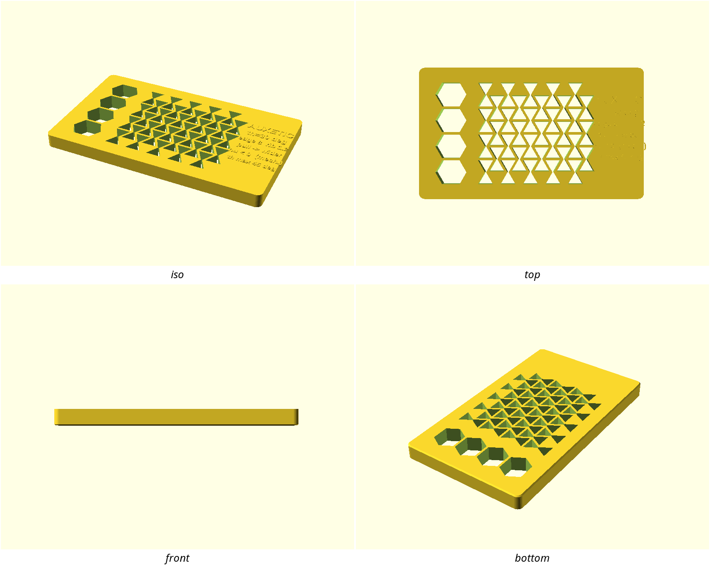
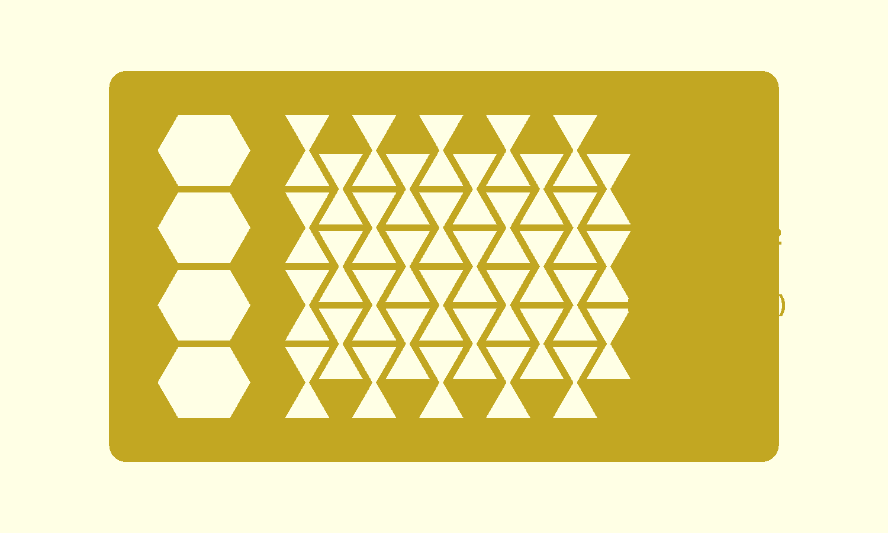
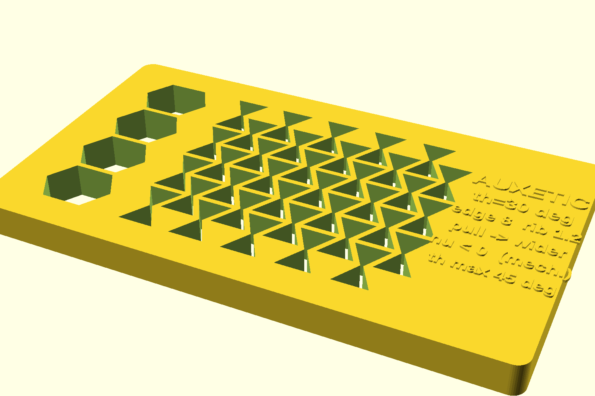
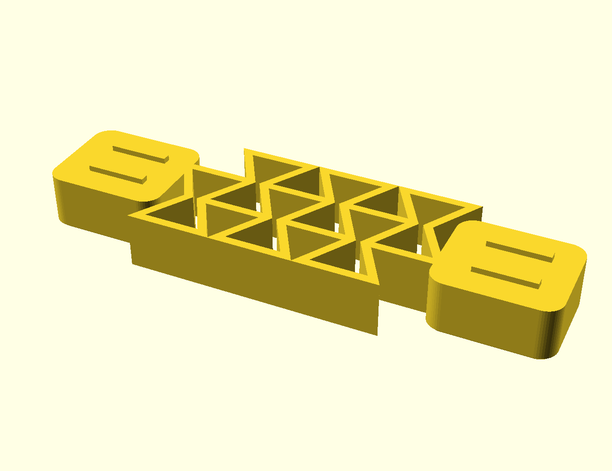

# auxetic-tile

A flat-printed **re-entrant honeycomb** that gets *wider* when you pull it —
negative Poisson's ratio from cell geometry, not a flexure joint. One tile
carries the auxetic lattice, a conventional honeycomb contrast column, and an
embossed callout of the live parameters and the mechanism; a 3-cell coupon
lets you feel ν < 0 on your own PLA.

## What you get

- `tile` — 120 × 70 × 8 mm framed lattice: re-entrant (auxetic) patch, one
  conventional contrast column on the left, solid callout strip on the right
  embossed with θ / edge / rib and the mechanism (`pull -> wider`, `nu < 0`).
  Prints flat, no supports.
- `coupon` — a 3-cell-wide open rib strip with grip tabs on the ends only
  (no solid rails) for a hand-stretch check.

The embossed numbers are computed inside the `.scad` from the same parameters
that build the mesh, so the strip cannot state a value the lattice didn't
use. It deliberately does **not** promise a numeric Poisson ratio —
published ν are upper bounds and strain-dependent on FDM cells.

## Print settings

- **Material:** PLA (the metamaterials note's assessment is PLA-specific).
- **Layer height:** 0.2 mm (the embossing is exactly two layers).
- **Nozzle / wall width:** 0.4 mm; keep ribs at the 1.2 mm default (3
  perimeters). Never thin below 0.8 mm.
- **Infill:** n/a on the lattice ribs (perimeters are the structure); any on
  the border/callout.
- **Supports:** none needed — every rib is vertical or within the 45°
  from-vertical printability bound.
- **Orientation:** flat on the bed as modelled (tile and coupon).

## Parameters

| Parameter | Default | What it does |
|---|---|---|
| `reentrant_angle` | 30° | slanted-rib angle from vertical — hard-capped at 45° |
| `cell_edge` | 8 mm | slanted rib length |
| `cell_horiz` | 10 mm | horizontal rib length (keeps the neck open at the 30° default; neck guard caps the shipped defaults near ~33°, below the 45° printability max) |
| `rib_width` | 1.2 mm | in-plane rib thickness (≥ 0.8) |
| `rib_depth` | 8 mm | out-of-plane thickness / print height |
| `tile_w` / `tile_d` | 120 / 70 mm | overall tile footprint |

All parameters are at the top of `auxetic-tile.scad`, grouped in Customizer
sections; override on the command line with `-D 'reentrant_angle=25'`.

## Assembly & use

1. Print the `coupon` first. Grip the tabs and pull gently along the strip —
   it should get **wider**. That is ν < 0. If it does not widen along the
   strip axis, try the transverse axis and log which way responded.
2. Print the `tile`. The left column is a conventional (outward-neck)
   honeycomb for **look-side-by-side** contrast with the auxetic patch (it is
   framed — not a pull comparison); the right strip repeats the parameters
   and the mechanism statement.
3. Log what you felt as a FIELD-TEST entry if you like
   (`templates/FIELD-TEST.md`) — qualitative is enough for v1.

## Preview shots

| Shot | What it shows |
|---|---|
|  | Whole tile, 3/4 — auxetic patch, contrast column, callout |
|  | Ortho top — re-entrant cells readable next to the contrast column |
|  | One re-entrant cell close up |
|  | Hand-stretch coupon with grip tabs |
