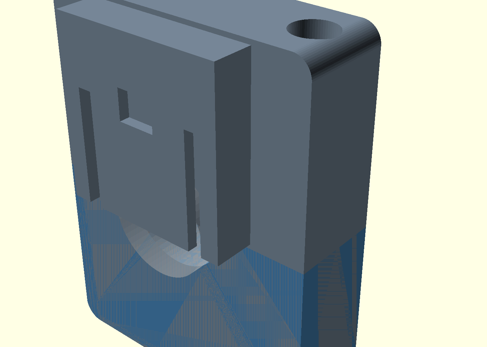
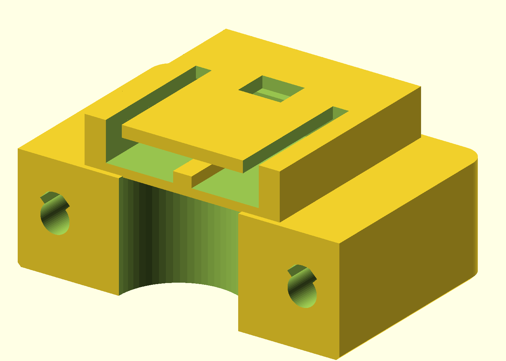
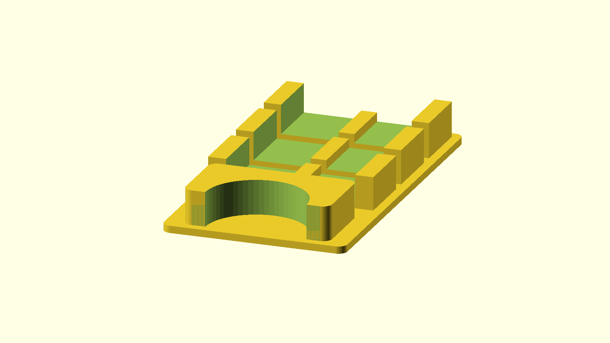
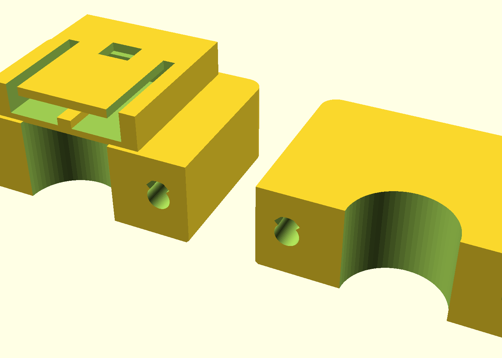
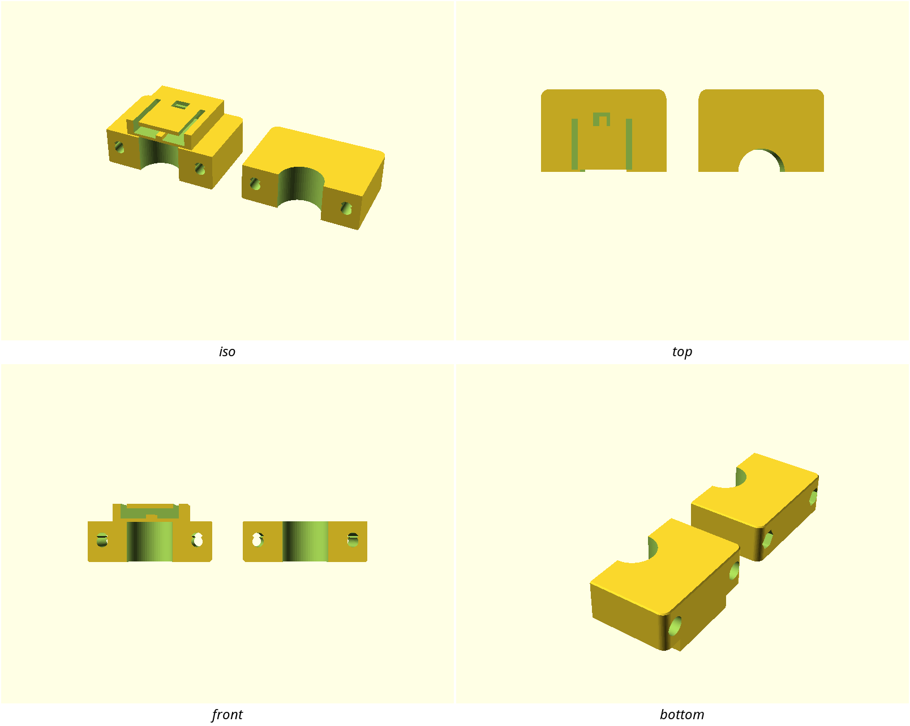

# bar-buckle-mount

A split clamp for the standard Ø22.2 mm flat-handlebar grip that presents
the de-facto action-cam **two-finger quick-release buckle** receiver — so
the camera, light, or remote that already lives in your drawer clicks on
and off the bar with no tools beyond the initial clamp install.

Two halves bolt around the bar with a purchased M5 + nyloc; one half
carries the buckle channel, the other seats the nut. Print flat on the
split face — no supports.

## What you get

- `clamp-receiver` — bar half with the buckle channel on the top pad
  (~60 × 40 × 29 mm as printed)
- `clamp-plain` — matching half with the nyloc hex recess (~60 × 40 × 20 mm)
- `coupon` — short bore section + three buckle-channel strips (print this
  first)

## Bill of hardware

| Qty | Item | Notes |
|---|---|---|
| 2 | M5×0.8 socket-cap screw | length ≥ 30 mm for the default shell; through both halves |
| 2 | M5 nylon-insert lock nut | seats in the plain half's hex recess |

Nothing in this design prints a thread into plastic.

## Print settings

- **Material:** PETG preferred (outdoor, vibration, drop-prone); PLA fine
  for dry-weather trials. Print the coupon in the **same material** as
  the clamp.
- **Layer height:** 0.2 mm
- **Perimeters:** ≥ 3 (walls are ≥ 1.2 mm; shell is 5 mm)
- **Infill:** 30–40 %
- **Supports:** none
- **Orientation:** each half flat on its split face; buckle channel opens
  upward
- **Brim:** 3–4 mm on the coupon if the first layer lifts

**Print the coupon first** before the halves — slide the bore onto a real
Ø22.2 grip (or a turned pin) and push a genuine two-finger buckle into
each channel strip. Tuning ladder is in `NOTES.md`.

## Parameters

The handful you are most likely to tune (all at the top of
`bar-buckle-mount.scad`, in Customizer sections):

| Parameter | Default | What it does |
|---|---|---|
| `bar_d` | 22.2 mm | Bar diameter — 25.4 / 31.8 for other ISO sections |
| `bore_clear` | 0.3 mm | Diametral bore clearance. Too tight on the coupon? Up 0.1. |
| `buckle_fit` | 0.2 mm | Extra clearance on buckle channel W/H. Coupon sweeps 0.0 / 0.2 / 0.4. |
| `buckle_rot` | 0 | `0` = buckle slides along the bar; `1` = slides across |
| `clamp_w` | 20 mm | Bearing width along the bar |
| `shell` | 5 mm | Radial wall outside the bore |

Buckle channel defaults (28.6 × 4.9 × 25.6 mm and the roof/guide table)
are the Abbott 2014 community-measured set — see `NOTES.md`. If your
buckle disagrees, change the parameters; do not guess new numbers.

## Assembly & use

1. Print `coupon`, check bore + buckle fit, tune if needed.
2. Print `clamp-receiver` and `clamp-plain`.
3. Seat the nylocs in the plain half's hex recesses.
4. Place both halves around the Ø22.2 grip section. The receiver faces
   **along the bar** (forward or aft) — that is the support-free print
   orientation; rotate the whole clamp on the bar to aim the camera.
5. Fit the two M5 screws from the receiver half through to the nylocs;
   snug until the clamp does not rotate on the bar under a firm twist.
6. Click a two-finger buckle into the receiver until the latch engages;
   press the buckle's release to remove.

