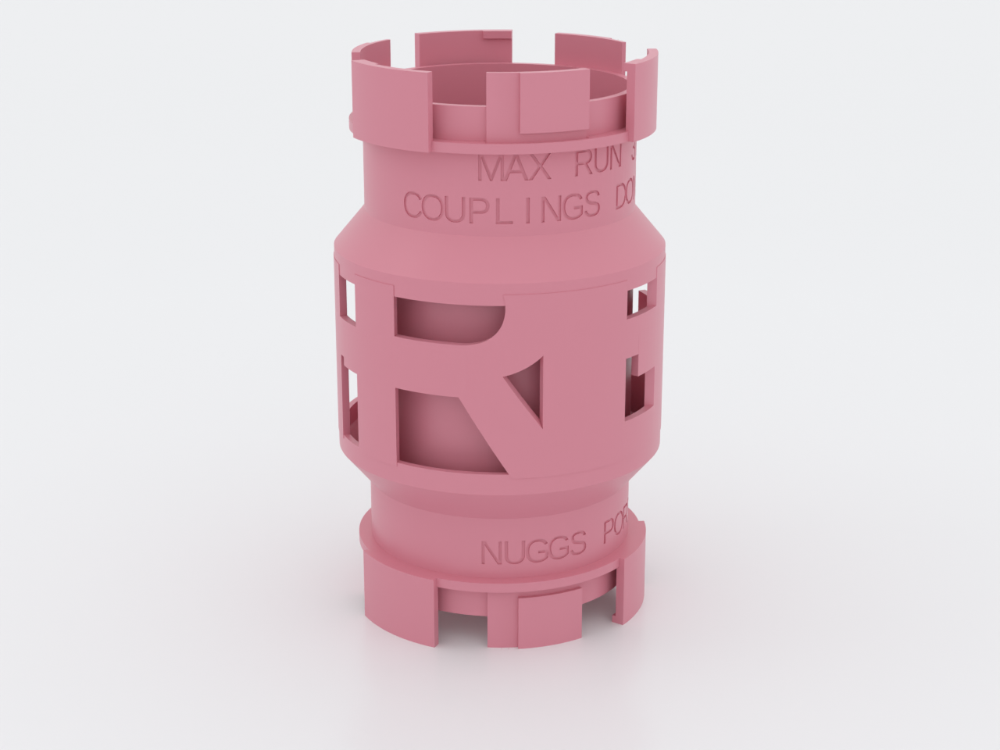
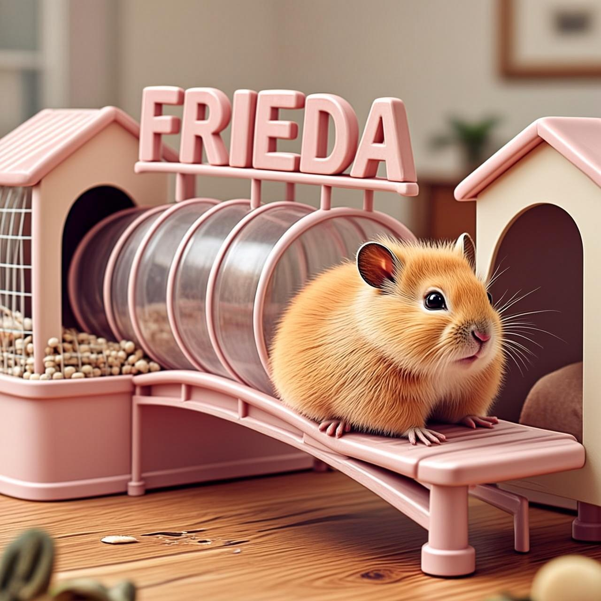
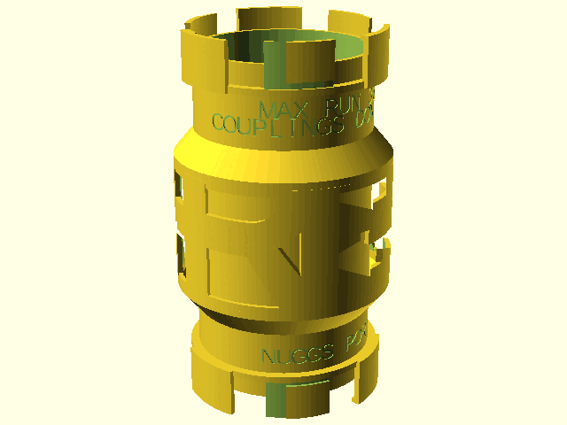
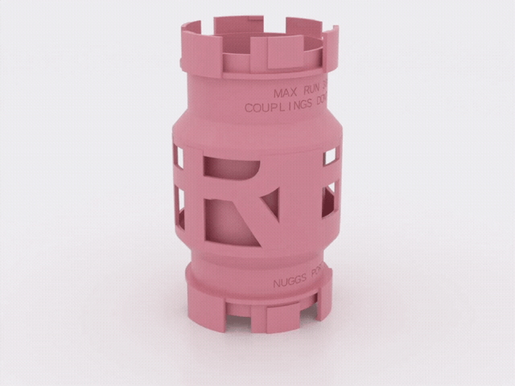
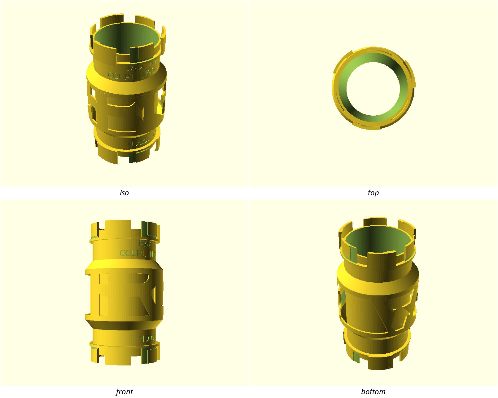
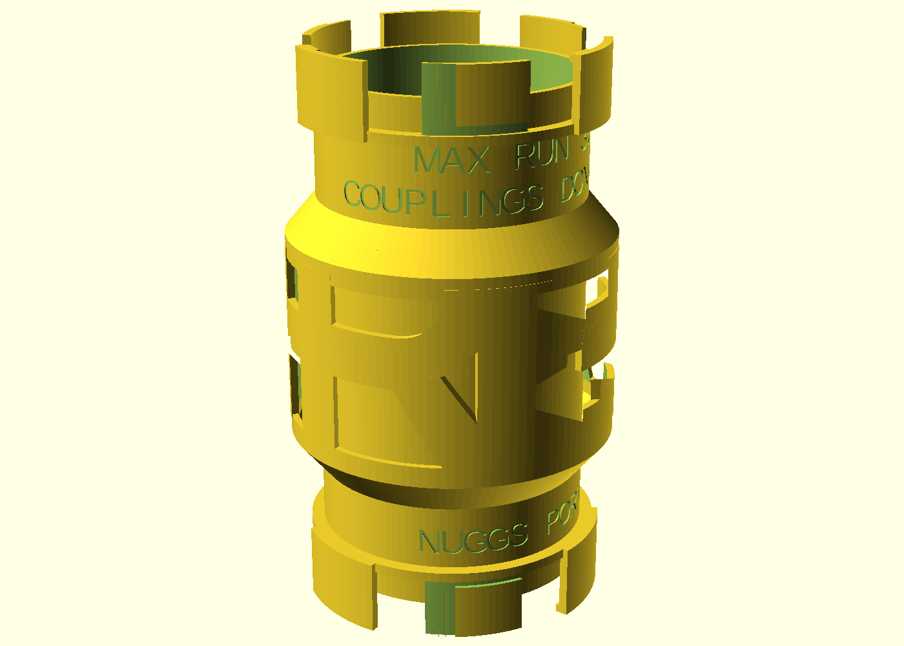

# nuggs-frieda

A [NUGGS](../nuggs/)-compatible hamster-tunnel module that is *made of its
resident's name*: a standard 80 mm-bore straight whose midspan wears a
structural letter cage spelling **FRIEDA**, Word-World style — the word wraps
≈ 280° around the tube between a base rail and a cap rail (the model echoes
249.9 mm of word against a 321.7 mm circumference). It carries the same
genderless quarter-turn port as every NUGGS module (same standard, same
revision, same defaults), so it couples with any of them, either way round,
and works as a drop-in replacement for the plain straight. Print it for the
hamster whose bridge should say whose it is.

The word wraps ≈ 280° — walk around it, or watch it turn.

*AI-generated impression for general illustration only — geometry is approximate and may not exactly match the printed part; see the studio render above and the STL for the true shape.*

*AI-generated motion impression for general illustration only — geometry is approximate and may not exactly match the printed part, and the movement shown is illustrative, not a simulation; see the deterministic previews above and the STL for the true shape.*

The name is a **second wall, not the enclosure wall**: inside the letter cage
runs a full, continuous, standard NUGGS tube, so the bore is never narrowed
(70 mm welfare floor), no opening between glyphs is reachable from inside,
and every letter edge stays outside the enclosure. A stencil tube — letters
as the bore wall itself — was considered and refused; the reasoning is in
[NOTES.md](NOTES.md).

## What you get

- `bridge` — the name bridge (Ø 104.8 mm over the letters, 180 mm end to
  end including both port projections; 160 mm face to face)
- `coupon` — two bore-clean port stubs (≈ Ø 97 × 35 mm each) to tune
  `port_tol` before committing to the full print. **Print this first.** CI
  prices the pair at about 5 h / 66 g; the two coupons together run about
  7–8 h — print them the night before the bridge.
- `wordpair` — include-and-override coupon that prints junction 0–1 of
  whatever `name` you set, at your `letter_kern` (for FRIEDA that is F→R;
  a rename like KATE rehearses K→A). Print this second to rehearse the weld
  bridges the port coupon cannot check — CI prices it at **3 h 14 m /
  ~36 g** against a ~16 h / ~206 g bridge. Print it in the same material as
  the bridge — a PLA rehearsal lies about a PETG weld — and the same-spool
  coupon doubles as the PETG bridge-speed tune. Hold the printed coupon to
  the light along the whole junction height (the mid-arm rib covers only
  part of the band). On the finished bridge, give every other junction —
  including FRIEDA's E→D — the same light check.

## Print settings

- **Material:** PETG preferred (hand-wash-only rule of the NUGGS system);
  PLA works. Expect the letter undersides to droop slightly in PETG — that
  is the cage shell, not the tube; PLA prints the letter cage cleaner. For
  PETG, slow the bridge speed to about 20–25 mm/s on the letter band and
  weld ribs. Expect the rules band to read soft in PETG; PLA prints it
  crisper.
- **Layer height:** 0.2 mm, 0.4 mm nozzle
- **Infill:** any — the part is almost all 2.4 mm walls (no infill to hide
  under-extrusion). Calibrate flow before the ~16 h bridge.
- **Supports:** none needed. Both cage skirts are 50° cones; letter
  internals print as short anchored bridges. Keep auto-supports OFF —
  anything the slicer plants under the letter band lands inside the 1.6 mm
  sleeve gap and can never come out.
- **Orientation:** upright, exactly as rendered — bore axis vertical. Bridge
  stands on one port's sector tips; wordpair coupon stands on one curved
  wall-arc under a ~65 mm part.
- **Seam:** Back (or scarfed) — a default Aligned seam stacks a ridge the
  full 180 mm height and can land on the word or a port sector. Rotate the
  part so the plain rail span (D→A, no letters) faces the back.
- **Brim:** Outer, 5 mm — don't leave it on Auto. Print it on the bridge (it
  stands 180 mm tall on three small sector tips) and on the wordpair coupon
  (one curved wall-arc under a 65 mm part). Bambu's Auto heuristic can skip
  a connected footprint like the coupon's wall-arc.
- **After the print:** snap the brim, then deburr each sector tip until a
  fingernail drags across without catching. The animal passes those tips
  most often; leave no sharp remnant at mouth height. Run the same
  fingernail test over the rail ledges and letter outer faces — those are
  the human twist grip, and wet palms land there every wash cycle.

## Parameters

| Parameter | Default | What it does |
|---|---|---|
| `name` | `"FRIEDA"` | The word. Capitals A–Z only (every glyph must anchor rail to rail; the file explains) |
| `letter_size` | 80 | Font size in mm; cap height ≈ 0.69 × this |
| `letter_kern` | `[12,0,0,12,0]` | Per-gap weld: mm removed after each glyph so free arm ends (F, E) fuse into the next stem; mid-arm ribs close what kern alone can leave open on the outer face |
| `port_tol` | 0.30 mm | The one fit knob of the whole port standard. Tune on the coupon in ±0.05 steps |
| `straight_len` | 160 mm | Face-to-face tube length. 160 = drop-in for the nuggs straight |
| `bore_d` | 80 mm | Internal bore. Asserted ≥ 70 mm (welfare floor) by the library — never lower that floor |

All parameters are at the top of `nuggs-frieda.scad`, grouped in Customizer
sections; override on the command line with `-D 'letter_size=70'`. Change a
`[The NUGGS standard]` parameter and nothing you already printed fits.

## Assembly & use

Couples like every NUGGS module: push the port faces together at the
insertion clocking, twist ~14° either way, done — and one twist opens it
again. The engraved rules on the tube are load-bearing, not decoration:
**MAX RUN 360MM / COUPLINGS DONT RESET** — modules twisted together are one
continuously enclosed run, so don't chain name bridges past the limit for a
180 mm animal (two of these coupled measure 340 mm of enclosed bore: legal,
and the ceiling). Grip the letter cage to twist; the twist load runs base
rail → skirts → the tube's continuous wall, not through the letter-arm welds
(those carry only the cage's own weight). It clears a mating module's
coupling ring by design. Hand wash only, ≤ 50 °C; water that gets between
the tube and the cage is designed to drain back out through the letter
openings.

Want a different name? Set `name` (capitals only) and review the kern: any
letter with free-ended arms (E, F, L, T) wants a weld into its right-hand
neighbour — see O3 in [NOTES.md](NOTES.md). Names that *end* on a free-arm
letter (E, F, L, T — e.g. KATE, RALF) have no right-hand neighbour to weld
into: either add a trailing stem letter or accept that last arm as a short
shelf. The wordpair coupon follows `name`: it prints *your* junction 0–1 at
*your* kern (include-and-override — no copied geometry). For FRIEDA that
rehearses F→R; under a rename it still clips glyphs 0–1, which may not be
the risky pair — hold the printed bridge to the light to check the others
(including E→D on FRIEDA). To rehearse any name's risky pair on the coupon,
set `name` to that two-letter pair (for example `"ED"` for FRIEDA's own E→D,
or `"TE"` for a terminal E) with that gap's `letter_kern` value; the coupon
follows `name`, so include-and-override prints exactly that junction. Check
every junction against
[`previews/weld-fr.png`](previews/weld-fr.png) (or a new close-up of your
own junctions) before committing filament.
