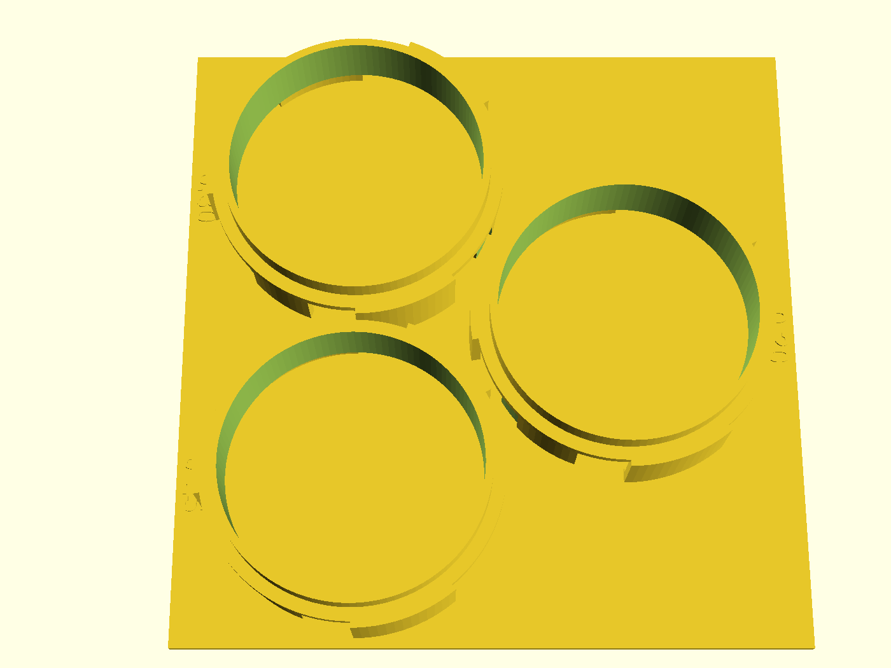

# NUGGS port gauge

A two-plate calibration gauge for the NUGGS quarter-turn port: one
**reference head** at nominal geometry and five embossed `port_tol` steps
(0.20 → 0.40) split across a 3-step plate and a 2-step plate. Mate the head
to each step — which won't seat or won't turn, which seats and clicks home,
which seats but wobbles — and pick your printer's `port_tol` with the rule
below.

If you will only ever build **one** NUGGS module, that module's own coupon is
the cheaper instrument. This gauge earns its keep from module two onward —
one calibration replaces N single-value coupon reprints.

## What you get

Three plate objects plus the coupon (the multi-object 3MF plate is the
deliverable — never a single merged STL):

- `reference-head` — one `nuggs_neck()` at `port_tol = 0.30` with a grip tab.
  Prints standing on sector tips (family pose). ≈ 123 × 95 × 31 mm.
  **CI estimate:** ~2 h 28 m / ~32 g PLA.
- `ladder-3` — steps **0.20 / 0.25 / 0.30** on one backplate, centres 97 mm
  apart (clears the Ø96.8 mating envelope). Value embossed 0.60 mm beside
  each ring. ≈ 200 × 198 × 33 mm.
  **CI estimate:** ~14 h 49 m / ~179 g PLA.
- `ladder-2` — steps **0.35 / 0.40**, same rules. ≈ 200 × 114 × 33 mm.
  **CI estimate:** ~9 h 14 m / ~111 g PLA.
- `coupon` — print-this-first: a reference stub and a receiving stub at
  0.30 — the same mate as the middle rung on `ladder-3` (~4 h 36 m vs
  ladder-3's ~14 h 49 m) to catch a bad first layer before the big plates.
  Comes off the bed as two loose rings by design — that's the test.
  **CI estimate:** ~4 h 36 m / ~60 g PLA.

**All four parts (CI estimates):** ~31 h / ~383 g PLA. Print the coupon and
reference head first; `ladder-3` alone is a ~15 h plate.

**Deliverable.** `./scripts/plate.sh nuggs-port-gauge` builds
`build/nuggs-port-gauge-plate.3mf` with three distinct objects. Import that
(or the three gated per-part STLs), keep them as separate objects in the
slicer, and print them as separate plates — the trio (and any pair) will not
co-fit a 256 mm bed.

## Print settings

- **Material:** PLA is fine for a gauge; PETG if it lives in a toolbox. Print
  all four pieces — head, coupon, and both plates — in the **same filament**.
- **Layer height:** 0.2 mm, 0.4 mm nozzle.
- **Infill:** 15–20 % gyroid.
- **Supports:** none. The ~53 mm tube-face bridge prints with a visible sag
  (three arcs per port) on every part — that is expected; do not add supports
  (they would have to come out through the 20° slots and scar the fit walls).
- **Seam:** scarf on both ladder plates and the reference head — a stacked
  Back ridge is 0.1–0.2 mm and biases every reading the same way. Adjacent
  rings print kissing by design (`step_pitch` 97 vs Ø96.8 envelope, ~0.2 mm),
  so scarf seam is required. Expect small webs where adjacent rings kiss —
  the designed 0.2 mm gap mostly closes in plastic; that is the slot welding,
  not a defect (`step_pitch` stays 97).
- **Orientation:** as modeled — standing on sector tips (plates on the
  backplate; reference head on tips + grip tab).
- **Brim:** 5 mm recommended on both ladder plates, the coupon, and the head
  (on the head, de-bridge the sector feet with a blade before gauging);
  remove with a blade and re-check flatness before gauging.
- **Bed:** each plate needs a 256×256 mm bed (ladder-3 ≈ 200×198; with brim
  ~210×208) — too large for 180-class machines such as an A1 mini. Print the
  three plate objects as separate plates; they will not co-fit one 256 bed.
- **Labels:** if the ~1 mm decimal point prints faint, the digits alone still
  identify the rung.
- **Handling:** the grip tab is a press-ledge, not a handle — press and
  twist; don't lift by the tab.
- **First layer:** the locking rib starts at Z=0 on the head and coupon, so
  first-layer squish is part of the gauge calibration — dial in the first
  layer and avoid elephant foot before trusting readings (ladder rings bury
  the same tips in the backplate and print clean).
- **First use:** debur the head's port face (blade or fingernail) before the
  first session — tip chamfer absorbs most first-layer flare, but a quick
  wipe still helps. Wipe a contrasting crayon or water-based marker across
  the embossed numbers before the first session to read them.
- **Storage:** bag the coupon rings between sessions — scratches become
  readings on this instrument.

## Parameters

| Parameter | Default | What it does |
|---|---|---|
| `ref_port_tol` | 0.30 mm | Nominal clearance on the reference head |
| `ladder_tols` | [0.20…0.40] | The five steps under test (do not drop values — HITL) |
| `step_pitch` | 97 mm | Centre spacing; must stay ≥ Ø96.8 mating envelope |
| `emboss_h` | 0.60 mm | Raised height of each step label |
| `shell_extra` | 8 mm | Full-round shell behind each port's `z_top` |

All parameters are at the top of `nuggs-port-gauge.scad`. Override on the
command line with `-D 'ref_port_tol=0.30'`.

## Assembly & use

1. Print the coupon first; mate and twist. **Binds** (won't seat or won't
   turn): fix first-layer squish / elephant foot before printing the plates.
   **Flops** (seats but wobbles): the printer probably wants a tighter
   `port_tol` — print `ladder-3` first; `ladder-2` may be skippable. The
   coupon is the catastrophe check; the tightest rung the head actually
   seats on the ladder is the number.
2. Print the three plate objects (3MF or separate STLs).
3. Start at **0.40** (widest seats easiest first). Flip the reference head
   port-face down onto a ring, line the lugs up with the gaps, quarter-turn
   to seat, and hold the plate flat with the other hand so the plate does
   not spin with you. Unseat and step down through 0.20. Score each rung in
   plain words as you go (won't seat or won't turn / seats and clicks home /
   seats but wobbles), and write the three words/scores down before running
   the second pass — or have someone else call rungs out of order — so pass
   2 does not anchor on pass 1 and the known 0.30 default does not bias the
   call. Run the round twice (0.40 down to 0.20, then back).
4. **Decision rule:** choose the tightest rung that seats and clicks home
   without binding; if that rung is within one step of 0.30, keep 0.30. Use
   that value on the next NUGGS coupon, and log a FIELD-TEST entry in that
   design's NOTES.md.
5. **Session-level outs:** if all five rungs bind, fix the first layer
   before blaming `port_tol`. If even 0.40 wobbles, the printer needs
   attention before the port does — this gauge cannot help upstream
   dimensional accuracy.
6. **Wear:** rings are PLA mating surfaces; heavy use drifts readings
   looser. Re-run the ladder against a fresh coupon if the gauge is a year
   old or heavily used.

## Licensing

BSD-family design code; the port geometry comes from `lib/nuggs-coupling.scad`
(BSD-2-Clause via the repo's first-party tree). No NopSCADlib / GPL opt-in.
