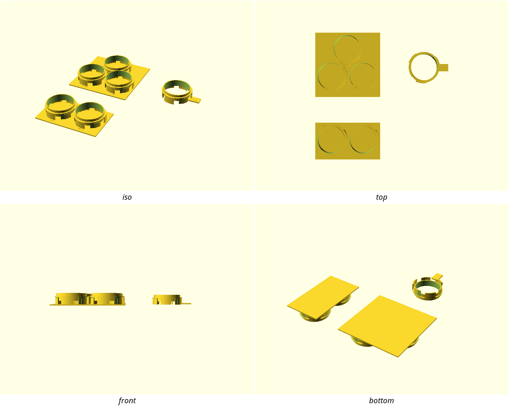
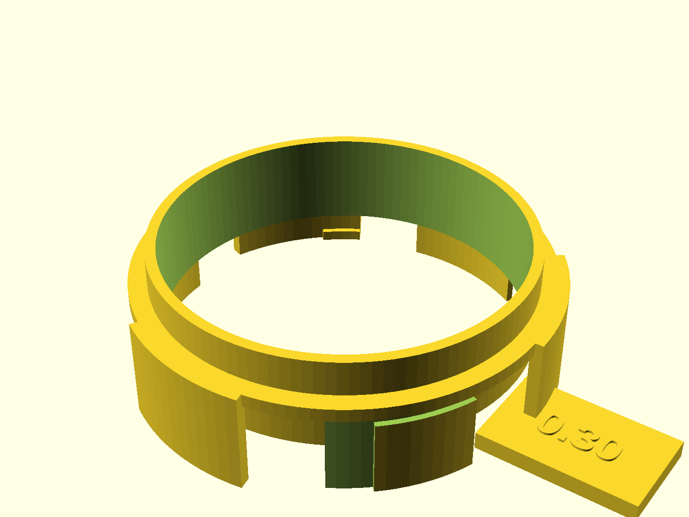
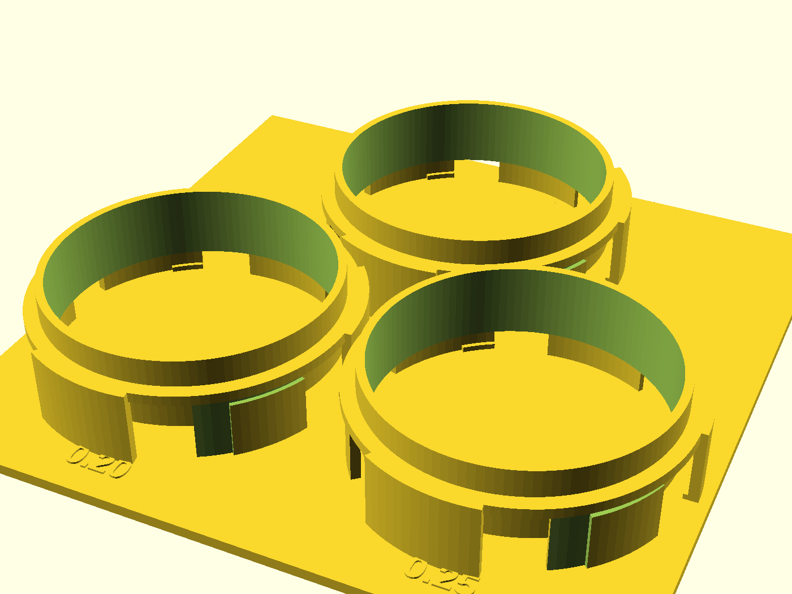
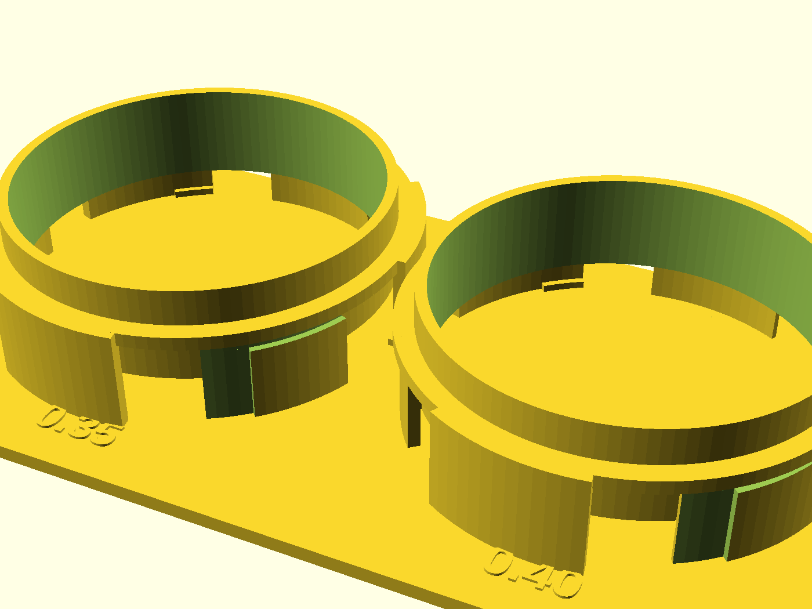

# NUGGS port gauge

A two-plate calibration gauge for the NUGGS quarter-turn port: one
**reference head** at nominal geometry and five embossed `port_tol` steps
(0.20 → 0.40) split across a 3-step plate and a 2-step plate. Mate the head
to each step, feel which welds, which locks crisply and which slops — the
winner is the `port_tol` every NUGGS module on that printer should use.

## What you get

Three printable objects (the multi-object 3MF plate is the deliverable — never
a single merged STL):

- `reference-head` — one `nuggs_neck()` at `port_tol = 0.30` with a grip tab.
  Prints standing on sector tips (family pose). ≈ 123 × 95 × 31 mm.
- `ladder-3` — steps **0.20 / 0.25 / 0.30** on one backplate, centres 97 mm
  apart (clears the Ø96.8 mating envelope). Value embossed 0.60 mm beside
  each ring. ≈ 200 × 198 × 33 mm.
- `ladder-2` — steps **0.35 / 0.40**, same rules. ≈ 200 × 114 × 33 mm.
- `coupon` — print-this-first: one nominal stub beside one 0.30 stub.

**Deliverable.** `./scripts/plate.sh nuggs-port-gauge` builds
`build/nuggs-port-gauge-plate.3mf` with three distinct objects. Import that
(or the three gated per-part STLs) and keep them as separate objects in the
slicer.

## Print settings

- **Material:** PLA is fine for a gauge; PETG if it lives in a toolbox. Print
  the coupon in the **same filament** as the plates.
- **Layer height:** 0.2 mm, 0.4 mm nozzle.
- **Infill:** 15–20 % gyroid.
- **Supports:** none.
- **Orientation:** as modeled — standing on sector tips (plates on the
  backplate; reference head on tips + grip tab).
- **Brim:** none needed; sector tips are the family's standard bed contact.

## Parameters

| Parameter | Default | What it does |
|---|---|---|
| `ref_port_tol` | 0.30 mm | Nominal clearance on the reference head |
| `ladder_tols` | [0.20…0.40] | The five steps under test (do not drop values — HITL) |
| `step_pitch` | 97 mm | Centre spacing; must stay ≥ Ø96.8 mating envelope |
| `emboss_h` | 0.60 mm | Raised height of each step label |
| `shell_extra` | 8 mm | Full-round shell behind each port's `z_top` |

All parameters are at the top of `nuggs-port-gauge.scad`. Override on the
command line with `-D 'ref_port_tol=0.30'`.

## Assembly & use

1. Print the coupon first; mate and twist. If it already binds or flops, fix
   first-layer squish before printing the plates.
2. Print the three plate objects (3MF or separate STLs).
3. Holding the reference head by the grip tab, seat it on 0.20, twist, unseat;
   repeat through 0.40.
4. Record weld / crisp / slop. The crisp step (or the tightest non-weld) is
   your printer's `port_tol` — use it on the next NUGGS coupon, and log a
   FIELD-TEST entry in that design's NOTES.md.

## Licensing

BSD-family design code; the port geometry comes from `lib/nuggs-coupling.scad`
(BSD-2-Clause via the repo's first-party tree). No NopSCADlib / GPL opt-in.
