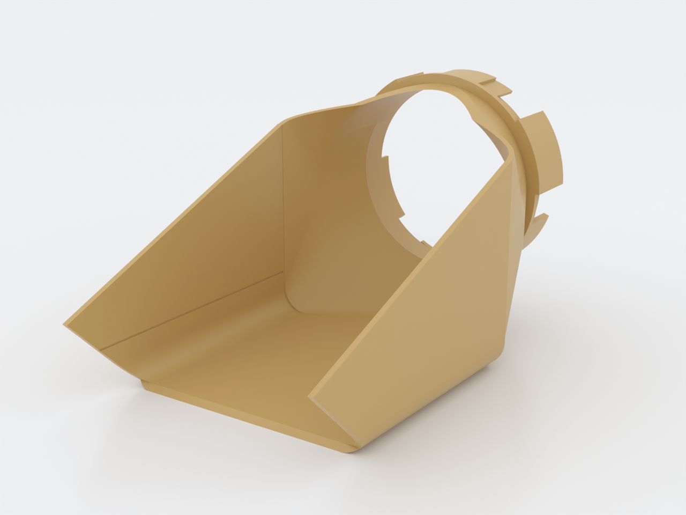
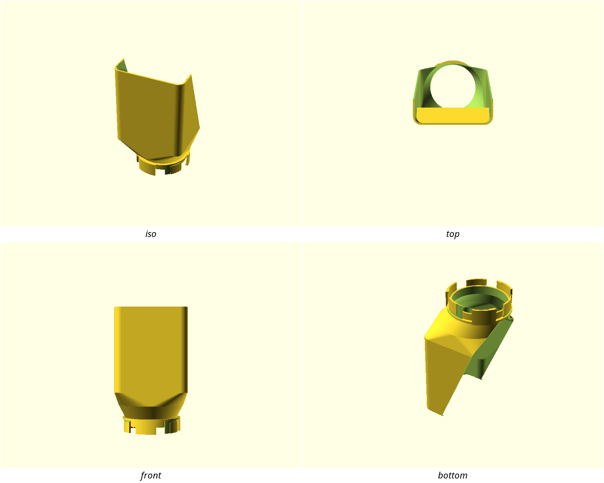
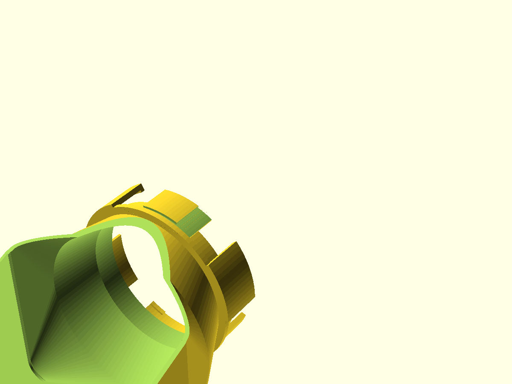
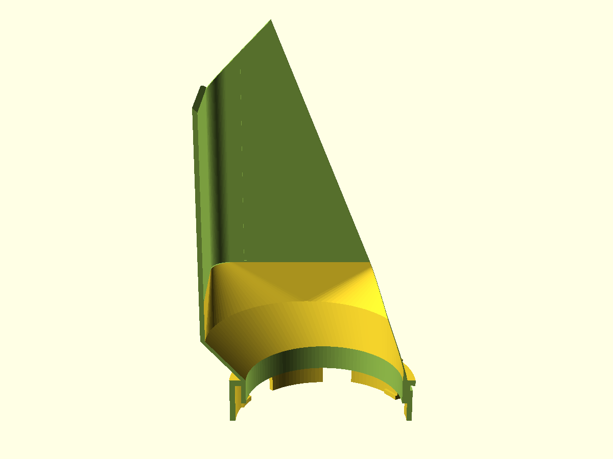

# NUGGS Sand Bath

The grooming module the NUGGS hamster-tunnel system was missing: an open-topped
bathing-sand dish that quarter-turns onto any standard 80 mm NUGGS port face.
The animal walks the bore, crosses a gentle ramp down to a wide sand floor,
rolls and grooms, and walks back out — and the sand stays in the dish, not the
run. One printed part, no supports, no hardware.

## What you get

- `body` — the sand bath module (approx. 115 × 109 × 197 mm printed; 110 mm
  inside width, ~245 mL of bathing sand, 18 mm deep)
- `coupon` — two port stubs to tune the coupling fit *before* the long print

## Print settings

- **Material:** PLA or PETG (PETG if it will be washed often or sees
  enthusiastic digging — sand is abrasive and PLA will haze at the sand line
  long before it's washed)
- **Layer height:** 0.2 mm, 0.4 mm nozzle
- **Infill:** 10–15 %
- **Supports:** none needed — every sloped surface is at or under 45°; leave
  slicer supports **off**
- **Orientation:** as modelled — standing on the port's sector tips, dish
  growing upward
- **Needs a ≥200 mm tall build volume** — a 180 mm machine cannot take this
  part at any setting
- **Brim:** yes, ~8 mm (or 4–5 mm plus a skirt ring) — the part stands on three
  small tips (a stability warning from the slicer is expected; the brim answers
  it). After pulling the brim, **trim it flush and deburr the sector tips and
  the mouth rim** (flat file or one pass of a blade held flat against the
  skirt / rim) before judging the fit — brim scar lands exactly on the bayonet
  engagement surfaces, and the raked mouth rim prints knife-edged
- **Seam:** Back (or scarf) — an Aligned seam stacks a ridge the full 197 mm
- **Print the coupon first** (see below) — the port tolerance is untested on
  any printer
- Roughly 9 h / 130 g for the body

## Print this first

`nuggs-sand-bath-coupon.scad` — two bore-clean port stubs (~4.5 h / 60 g; same
brim as the body). **Print the coupon in the same material you will print the
bath in** — what the coupon's first 2 mm says about elephant foot (and groove
legibility) is what the body will do. The two stubs are deliberate: mate them
to each other so you can tune the pair without touching the habitat. (If you
already own a NUGGS module, mating one stub to that works too.) If the stubs'
first layers mate stiff, dress the tips or enable elephant-foot compensation
0.1–0.2 mm rather than raising `port_tol` for the whole joint; otherwise tune
`port_tol` in ±0.05 mm steps until the quarter-turn locks without rock.

## Parameters

The handful worth tuning — the rest live at the top of
`nuggs-sand-bath.scad` in Customizer sections, overridable with
`-D 'param=value'`.

| Parameter | Default | What it does |
|---|---|---|
| `sand_depth` | 18 mm | Bathing sand depth on the floor (welfare guidance: 2–3 cm; must stay ≥ 2 mm below the lip). **18 mm is the answer at the stock 200 mm ceiling**; a full 2 cm needs the taller-printer route (`-D floor_run=140 -D max_build_height=250`, ≥250 mm) plus `-D sand_depth=20 -D lip_h=22` so `lip_h − sand_depth ≥ 2` still holds |
| `floor_run` | 96 mm | Flat floor length — the capacity knob. On a printer taller than 200 mm, `-D floor_run=140 -D max_build_height=250` buys a bigger bath |
| `dish_w` | 110 mm | Inside width of the dish, across the port axis |
| `lip_h` | 20 mm | Containment lip: port invert above the dish floor |
| `freeboard` | 15 mm | Dish wall height above the sand line |
| `port_tol` | 0.30 mm | The one fit knob — coupling clearance, tuned on the coupon in ±0.05 mm steps |

## Assembly & use

Quarter-turn the module onto any NUGGS port face — it is genderless, so either
way round, and it locks with a twist in either direction. **Layout (pending
owner confirmation, issue #667):** the engineering notes treat an open-topped
dish at the end of a run as a run break under the NUGGS length rule (same
reasoning as an open module) — mount it as a destination, not mid-run passage —
but that ruling is not final until the owner confirms on the issue thread.

Fill through the open mouth with **bathing sand (0.1–0.5 mm grain) — never
chinchilla dust**, which is a respiratory irritant for hamsters. Pour until the
sand sits **15 mm below the low rim** (18 mm above the floor) — that rim-relative
line is the designed fill; eyeball it from any angle. Confirm with a fingertip
along either long side wall: a shallow groove (1.2 × 1.5 mm) runs the length of
both long side walls at that sand line. About 245 mL reaches it. Expect some
sand out nightly and sweep the port mouth occasionally — that is the hamster
doing it right, not the design failing (the lip sits only 2 mm above the sand
line at the port, by the design's own `lip_h − sand_depth ≥ 2` assert); the
15 mm freeboard catches dig-kick on the trough. **Sift weekly; replace when the
sand clumps or soils** — the groove is not a dipstick for tired sand. After the
first few weeks, rock-check the mount (a filled bath is ~0.65–0.7 kg a hand-span
out on one port); re-seating is a quarter-turn. To clean, hand-wash the dish
(NUGGS family **N7**): ≤ 50 °C only, mild unscented dish soap is fine, rinse
and dry fully — **never a dishwasher** (the heated dry cycle exceeds even PETG,
and a warped port is a narrowed bore). No glued seams; everything is printed.

