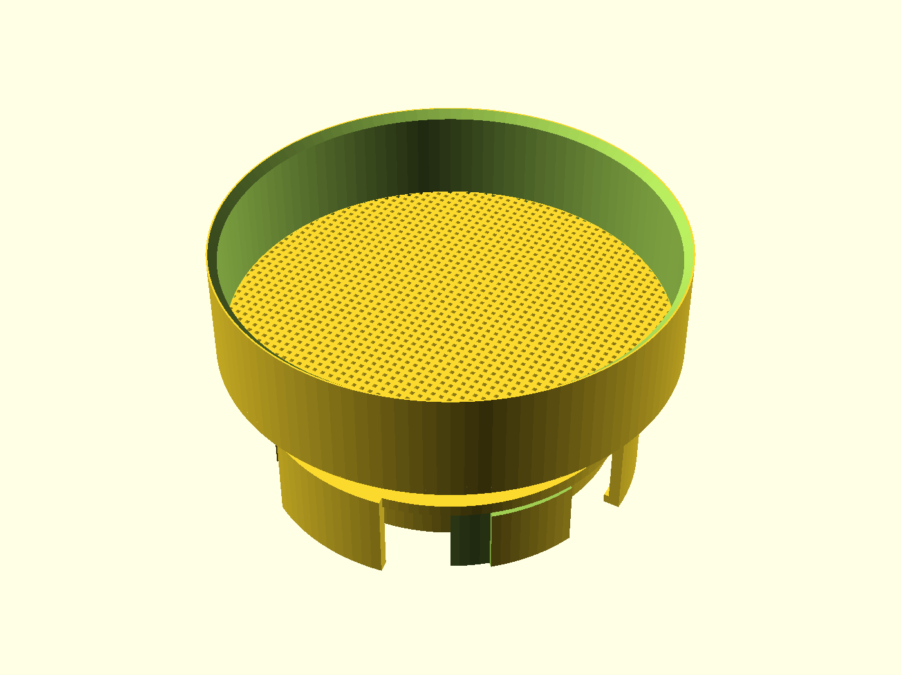
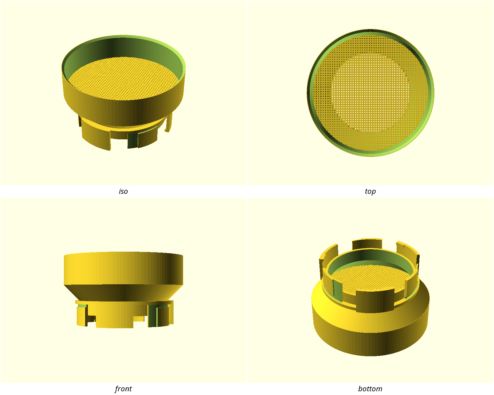
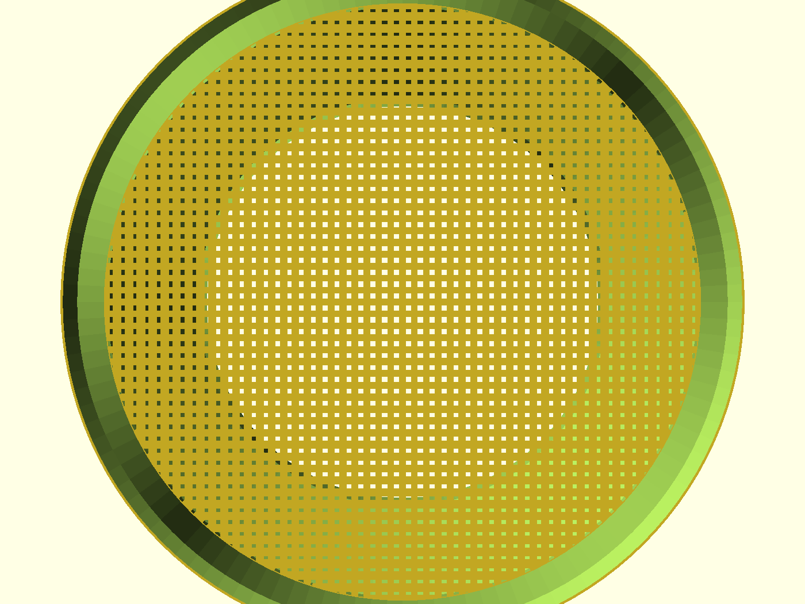
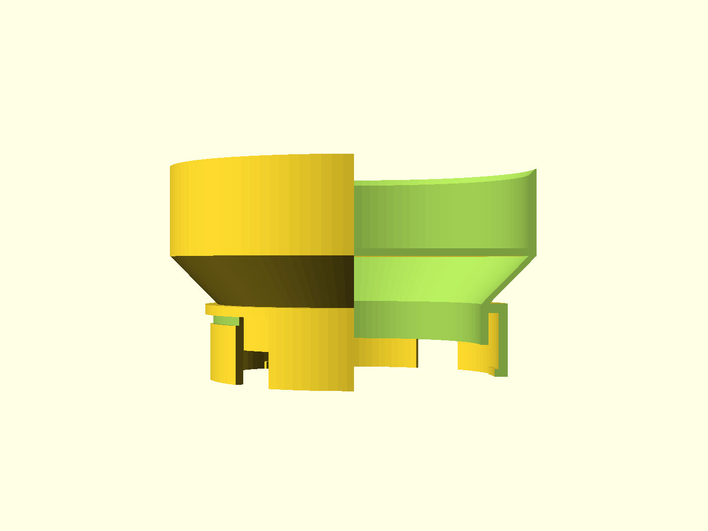

# NUGGS sand sieve

A bathing-sand **sieve end-cap** for the 80 mm-bore N.U.G.G.S. system: a
shallow open basket with a printed grid floor and one standard quarter-turn
port on the underside. Dock it on the sand bath (or hold it over a bin), pour
used sand in the top, shake gently — clean grains fall back through the grid
and the bore; debris stays in the basket to tip out. The maintenance half of
the sand-bath kit.

## What you get

- `sieve` — the basket end-cap (approx. Ø115 mm across the mouth, ~60 mm tall
  tip-to-rim; 80 mm bore, ~238 mL working volume above the grid).
- `coupon` — port stub + one grid tile at production hole/web sizes. Print
  this first; see [`NOTES.md`](NOTES.md).

One printed part. The port face is every `nuggs_cfg()` default, so it mates
with the sand bath, the straight, the elbow — any module on the standard.

## Print settings

- **Material:** PLA or PETG (PETG if you wash it often — sand is abrasive)
- **Layer height:** 0.2 mm
- **Infill:** 15 % grid
- **Supports:** **none** — flare ≤45°, walls vertical, pour lip 45°
- **Orientation:** as modelled — port axis vertical, standing on the coupling's
  sector tips, mouth up
- **Brim:** none; the sector tips are the family's standard bed contact
- **Seam:** Back (or scarf) — stock Aligned can ridge the coupling ring and
  eat into `port_tol`

## Parameters

| Parameter | Default | What it does |
|---|---|---|
| `hole_d` | 1.0 mm | Clear grid opening (square). Passes bathing sand; retains 2–5 mm debris. Step to **1.2** if printcheck flags webs — never thin `web_w` below 1.2. |
| `web_w` | 1.2 mm | Web width between openings — the wall floor. |
| `basket_depth` | 25 mm | Inside depth above the grid. |
| `top_id` | 110 mm | Open top inner diameter — matches the sand-bath mouth. |
| `lip_chamfer` | 2.0 mm | 45° pour-lip depth at the rim. |
| `port_tol` | 0.30 mm | The fit knob. **Unmeasured** — tune on the coupon in ±0.05 steps. |
| `bore_d`, `wall`, … | 80 / 2.4 | The NUGGS standard. Changing these un-mates every module you already printed. |

All parameters are at the top of [`nuggs-sand-sieve.scad`](nuggs-sand-sieve.scad),
grouped in Customizer sections; override on the command line with
`-D 'hole_d=1.2'`.

## Use & care

- **Fit:** push onto any NUGGS port face and twist a quarter turn. Tune
  `port_tol` on the coupon first if it rocks or binds (0.30 is the standard's
  default and has never been measured on a printer).
- **Sift:** dock on the sand bath's mouth (or hold over a bin), pour used
  sand in, shake gently, tip debris out. Re-seat the bath when done.
- **Sand, not chinchilla dust:** fill and sift **bathing sand (0.1–0.5 mm
  grain) only — never chinchilla dust**, which is a respiratory irritant for
  hamsters. Same welfare line the sand bath carries.
- **Wash / heat:** hand-wash ≤ 50 °C, mild unscented dish soap, rinse and dry
  fully — **never a dishwasher** (the heated dry cycle exceeds even PETG, and
  a warped port is a narrowed bore). PLA/PETG at a room-temperature rinse is
  fine; food-safe claims are out of scope for v1.

## Follow-ups

A finer **woven steel drop-in replacement mesh** is a named follow-up, not
v1 — the printed grid is the subject of this design.
