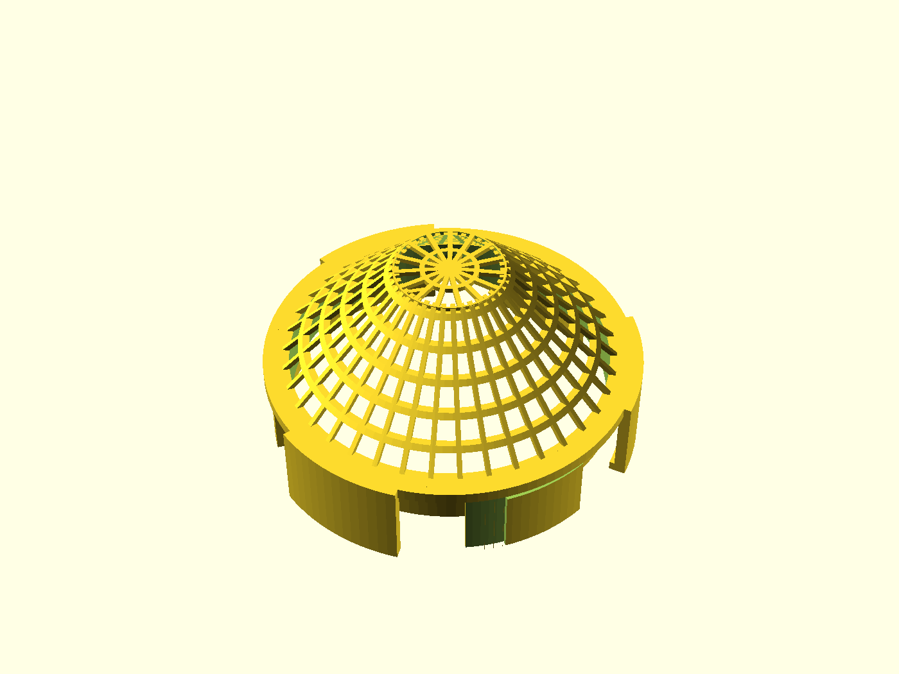
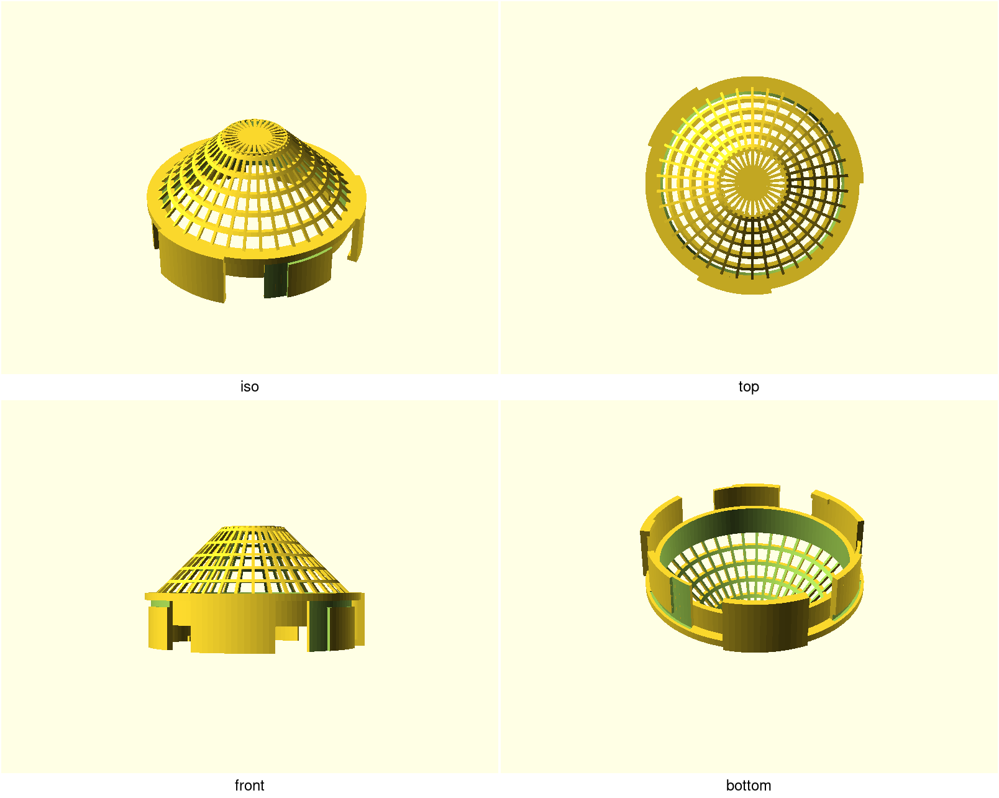
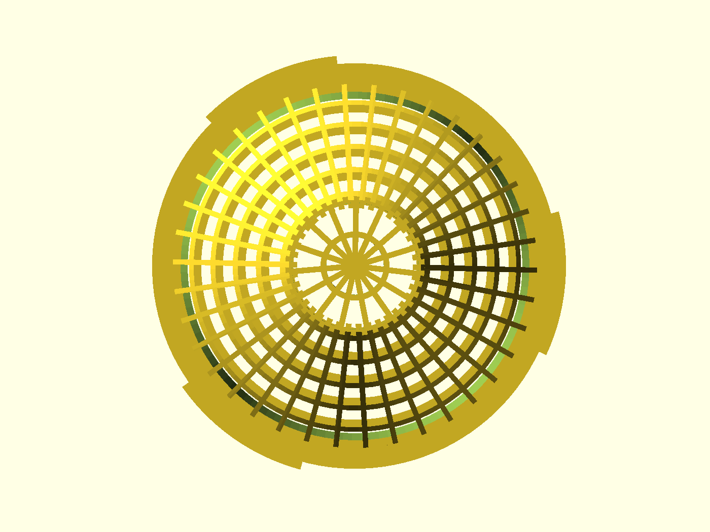
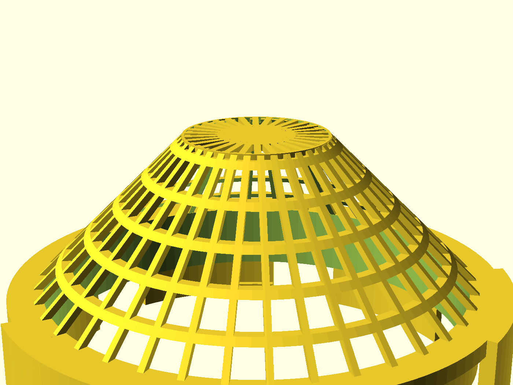
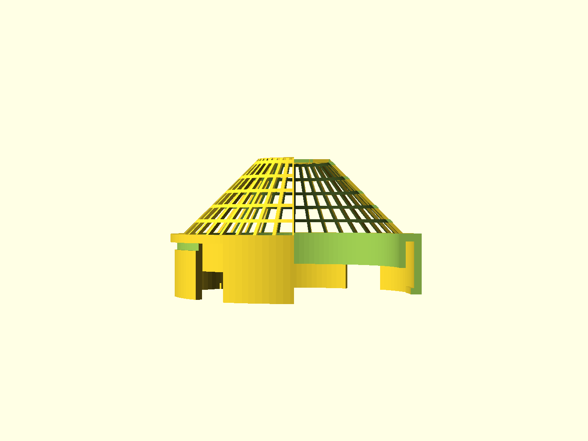

# NUGGS vent cap

The breathing end-cap: the standard NUGGS quarter-turn port closed by a
support-free **lattice dome**. Air and light pass, bedding stays in, and
openings stay at or under the assumed 6 mm welfare ceiling (the 1/4″
hardware-cloth convention — owner confirmation on a live animal is still
pending) — an enclosed run end that doesn't seal the system dead.
Prints upright with no supports, clicks into any existing NUGGS module, and
tunes its whole welfare envelope with two numbers.

## What you get

- `vent-cap` — the lattice cap. **Ø94.9 mm** across the coupling ring, **51 mm**
  tip-to-crown (41 mm of that above the port face), 80 mm bore. ~30 g in PETG
  at 15 % infill (slice-measured).
- `vent-cap-solid` — the closed variant: a hollow 45° cone closed near the
  tip (open underside, no flat ceiling across the bore), **65 mm** tall
  (gated export 64.7 mm). See **Solid variant** below.
- `coupon` — if you've already dialed `port_tol` on another NUGGS module on
  this printer, reuse that value and print just the cell:
  `openscad -D 'part="coupon-cell"' -o cell.stl designs/nuggs-vent-cap/nuggs-vent-cap.scad`
  (or Customizer → `coupon-cell`). New to the standard here: the
  print-this-first plate is a port stub beside one lattice cell at production
  pitch — about **2 h 18 m / ~30 g** (slice-measured), about the same as the
  lattice cap. Caliper `strand_w` and the opening at the **top face, not the
  base** (first-layer squish narrows the opening at its base; the dome's
  openings print well above L1). If the stub scratches on first insertion
  then firms up past the tip, scrape the elephant foot off the sector tips
  with a blade before touching `port_tol`. See [`NOTES.md`](NOTES.md) for
  the tuning steps.

The cap is one printed part. Its port face is every `nuggs_cfg()` default, so
it mates with the straight, the elbow, the den, the turnaround — any module on
the standard.

## Solid variant

The photos are the breathing lattice. The same file also ships a **closed**
cap — pick it when you want to terminate a run dead rather than breathing
(dark nesting, light blocked, almost no airflow). Same 45° cone as a hollow
shell closed near the tip (open underside so it prints support-free like the
lattice — no flat disk across the bore), no crown bridge; physics makes it
taller, **65 mm** tip-to-crown versus the lattice's 51 mm — about **2 h 42 m / ~35 g**
versus the lattice's **2 h 47 m / ~30 g** (slice-measured). Hollowing the cone
(open underside) cuts the filled-cone plastic from about **57 g** to about
**35 g** — roughly 40 % less — while keeping the support-free claim. The
shell is 1.2 mm (`strand_w`); if darkness is the point, print it in an
opaque, dark filament.

CI gates and slices it as `vent-cap-solid`
(`build/nuggs-vent-cap-vent-cap-solid.stl`). In the Customizer, set `lattice`
to false; on the command line, `-D lattice=false` or
`-D 'part="vent-cap-solid"'`. **Use & care below applies to this cone too**,
including family **N7** (hand-wash ≤ 50 °C, never a dishwasher) — a closed
tip traps more humid air than the lattice.

## Print settings

- **Material:** PETG (gnaw-durable); PLA fine for a calm cage. Print the
  coupon in the **same filament** as the cap — PETG fits run ~0.1 mm tighter
  than PLA, so a PLA coupon does not prove a PETG cap. PLA prints the
  cleanest lattice; PETG sags and strings on the small bridges — a heat gun
  or side-cutters tidy whiskers before fitting (animal elsewhere). For a
  chew-facing preset, raise `strand_w` to **1.6** and stay on PETG. Either
  way, family N7 still applies — see Use & care
- **Layer height:** 0.2 mm
- **Infill:** 10–15 % grid, guides only — the lattice is the structure
- **Seam:** Back (or scarf) — stock Aligned stacks a ridge on the Ø94.9
  coupling ring and can eat into the 0.30 mm of `port_tol`
- **Supports:** **none** — the dome is a 45° lattice cone by design; every
  strand underside is a sub-5 mm bridge, and the crown disc bridges its own
  ~10 mm spokes
- **Orientation:** as modeled — port axis vertical, standing on the coupling's
  sector tips
- **Brim:** none; the sector tips are the family's standard bed contact

## Parameters

| Parameter | Default | What it does |
|---|---|---|
| `aperture_max` | 6.0 mm | Largest passage through the lattice — the welfare number. The ¼″ hardware-cloth convention for a Syrian (**convention; confirm for your animal**); **dwarf keepers: 5.0**. An assert refuses anything over 6.0. |
| `strand_w` | 1.2 mm | Lattice strand width — three perimeters at a 0.4 mm nozzle. Raise to 1.6 (with PETG) for chew durability, or if your printer under-extrudes thin strands. |
| `dome_rise` | 28.0 mm | Dome height above the port zone. The length-vs-bridge trade: lower = shorter cap, bigger crown bridge. A droopy PETG crown means raise `dome_rise` 2–3 mm (taller cap, shorter crown bridges); lowering only buys ~1 mm before the assert fires (`dome_rise ≥ ri−13` = 27 at defaults). |
| `port_tol` | 0.30 mm | The fit knob. **Unmeasured** — tune on the coupon in ±0.05 steps before printing the cap. |
| `lattice` | true | false = the solid variant (`vent-cap-solid`): blocked, taller. |
| `bore_d`, `wall`, … | 80 / 2.4 | The NUGGS standard, at `nuggs_cfg()` defaults. Changing these un-mates the cap from every module you already printed. |

All parameters are at the top of [`nuggs-vent-cap.scad`](nuggs-vent-cap.scad),
grouped in Customizer sections; override on the command line with
`-D 'aperture_max=5'`.

## Use & care

- **Fit:** push onto any NUGGS port face and twist a quarter turn. It should
  click firm with no rock — if not, tune `port_tol` on the coupon first
  (0.30 is the standard's default and has never been measured on a printer).
- **Clocking:** any quarter-turn position seats; the port is genderless like
  the rest of the system.
- **Condensation and wash (family N7):** both the lattice and the solid
  variant trap humid air at the tip — the closed cone more so. In humid
  rooms, pull and dry the cap weekly, and keep bedding off the dome's
  underside. Bedding also packs the port's lug pockets — blow them out when
  you pull the cap. When you wash it, hand-wash either cap (NUGGS family
  **N7**): ≤ 50 °C only, mild unscented dish soap is fine, rinse and dry
  fully — **never a dishwasher** (the heated dry cycle exceeds even PETG,
  and a warped port is a narrowed bore).
- **Chew / welfare:** the 6 mm aperture is a mesh convention, not a chew
  proof — inspect the widest (lowest) cells weekly and treat the lattice as
  replaceable if the resident gnaws. A chewed-through cap is a reprint (about
  2 h 47 m / about 28.5 g per episode), not a repair; there is no dome-only
  spare.
- **Airflow:** the lattice holds ≥ 30 % open area by construction. If a keeper
  reports stuffiness, the lever is `aperture_max` (within the welfare ceiling)
  — never thinner strands.
- **Filtration:** this is a vent, not a dust filter. Fine particulate
  filtration is out of scope by design.
- **No hardware:** nothing to buy — no mesh, no screws, no glue.

## Design notes

The dome's shape is forced by an integral, not a taste call: support-free
surfaces climb at most 45°, so a *continuous* closure of an 80 mm bore needs
≥ 40 mm of rise — more than the cap-length budget holds. The lattice cone
spends its 28 mm of rise closing 28 mm of radius and hands the last 12 mm to a
bridged crown disc. The full derivation, the welfare numbers and the
decisions log live in [`NOTES.md`](NOTES.md).
