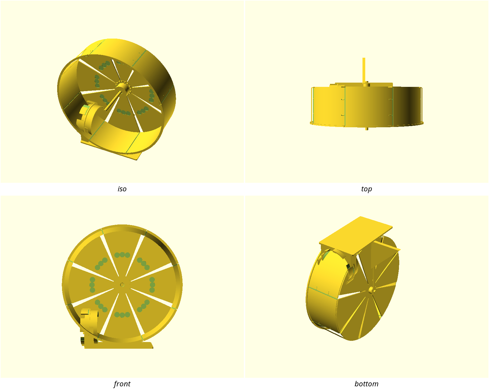
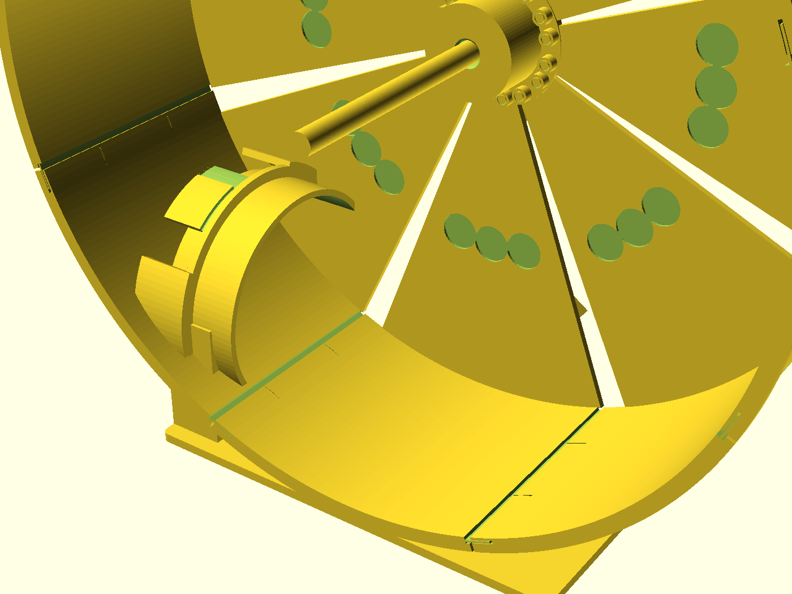
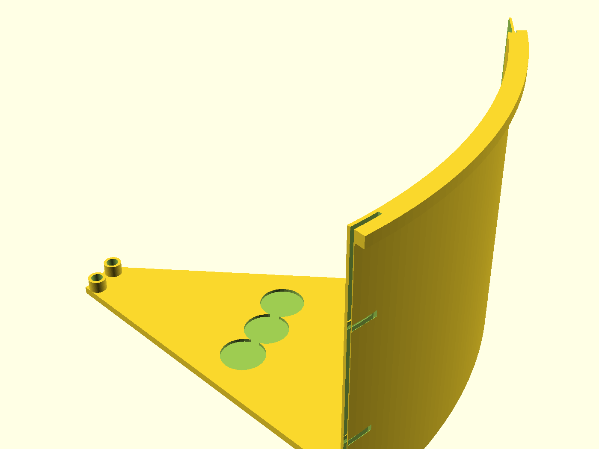

# NUGGS wheel

The **exercise module** for the N.U.G.G.S. hamster-tunnel system: a segmented
rim wheel on a free-standing stand that quarter-turns into a standard 80 mm
genderless port so it stays put without hardware. Syrian-scale by default
(Ø280 × 90 mm), printed in identical segments so every part clears a ~180 mm
bound under the gate's 200 mm test-slice ceiling.

> **Work in progress — nothing in this system has been printed yet.**
> `port_tol = 0.30` is an untested guess inherited from the shared standard.
> **Print the coupon first** and expect to tune port, joint, and axle fits.

## What you get

Separately printed parts — the deliverable is the multi-object 3MF plate
(`build/nuggs-wheel-plate.3mf`), not a single assembled STL (that would fuse).

- `rim-segment` × **8** (identical) — arc of running surface + closed back pie +
  shingle joint (≈ 155 mm XY diagonal at defaults). About **3h 28m / 44 g**
  each (Manifold nightly slice)
- `hub` — axle carrier with posts into the segment pads (Ø48 × 22 mm);
  about **1h 4m / 12 g**
- `stand` — footplate + axle arm + NUGGS port anchor (168 × 100 mm footprint;
  use height about **164 mm**). About **8h 51m / 120 g**
- `axle` — Ø8 plain shaft, loose / repairable; about **22m / 5 g**
- `coupon` — port stub + joint pair + axle-in-bore sample. About
  **3h 9m / 36 g** — not a 20-minute stub: one plate carries the port,
  joint, and axle trio so you dry-fit all three fits before the rim farm

Whole set (8× rim + hub + stand + axle) is roughly **38h / 490 g** before the
coupon — plan a weekend, not one evening.

## Print settings

- **Material:** PETG for rim segments and hub (impact at the joints); PLA fine
  for the stand and axle. Coupon in the **same filament** as the part it tunes
- **Layer height:** 0.2 mm
- **Infill:** 15–20 % (stand/hub); ≥ 20 % for rim segments
- **Supports:** **none**
- **Orientation:**
  - rim-segment / hub — back flat on the bed
  - stand — port-down on the coupling sector tips (family pose; foot is
    vertical during print, on the floor in use)
  - axle — on its side
- **Brim:** optional on the sector tips if adhesion is weak. In the print
  pose (port-down, foot vertical) the stand's longest mesh AABB is
  **~178 mm on Z** (height) against the **180 mm** CI/printcheck part
  bound on purpose (2 mm headroom) — a brim never changes that axis. Bed
  footprint is about 153 × 166 mm, so a normal ~5 mm brim fits on a
  200 mm bed; the 180 mm bound is the gate envelope, not your bed size.
  Do not expect a geometry shrink for the Z headroom

## Parameters

| Parameter | Default | What it does |
|---|---|---|
| `wheel_d` | 280 mm | Running-surface diameter — set to your animal; ≥ 200 asserted (Syrian welfare floor; do not lower to buy clearance) |
| `wheel_w` | 90 mm | Tread width |
| `n_seg` | 8 | Identical rim segments (derived from the 180 mm bound at Ø280) |
| `joint_lip` | 1.0 mm | Printable female shingle lip land (two-plus extrusion lines) |
| `joint_step` | 0.20 mm | Radial seam step the paw feels; asserted ≤ 0.25 mm |
| `wheel_floor_clear` | 15 mm | Under-tread clearance; sets axle height (155 mm) and about 6 mm lip-to-footplate gap |
| `axle_clear` | 0.35 mm | Diametral bearing clearance — **quiet running lives here** |
| `port_tol` | 0.30 mm | NUGGS fit knob — **unmeasured**; tune on the coupon |
| `stand_depth_mult` | 0.60 | Foot depth as a fraction of `wheel_d` |

All parameters are at the top of [`nuggs-wheel.scad`](nuggs-wheel.scad),
grouped in Customizer sections; override with `-D 'wheel_d=300'`.

## Assembly & use

1. **Coupon first** — see [`NOTES.md`](NOTES.md) “Print this first”.
2. Print 8× `rim-segment`, 1× `hub`, 1× `stand`, 1× `axle` (or slice the plate).
3. Shingle the segments into a rim (pegs locate; lap has no butt gap). Seat
   the hub posts into the inner pads.
4. Pass the axle through the stand boss and hub; retain with a drop of
   filament rivet or a printed collar if you want (v1 ships loose).
5. Quarter-turn the stand's port into any NUGGS face to anti-slide anchor it;
   the foot stands free on a flat floor either way.

**Use height** at defaults is about **164 mm** (axle at 155 mm). Keep the stand
on a firm level surface — the CoG tip check assumes a flat floor, not deep
bedding.

**Layout:** a destination at an enclosure, not a bore-through mid-run module
(see NOTES — run-break ruling). Open front toward the enclosure; closed back
toward the stand arm.

**Care (family N7):** hand-wash ≤ 50 °C; never a dishwasher.
