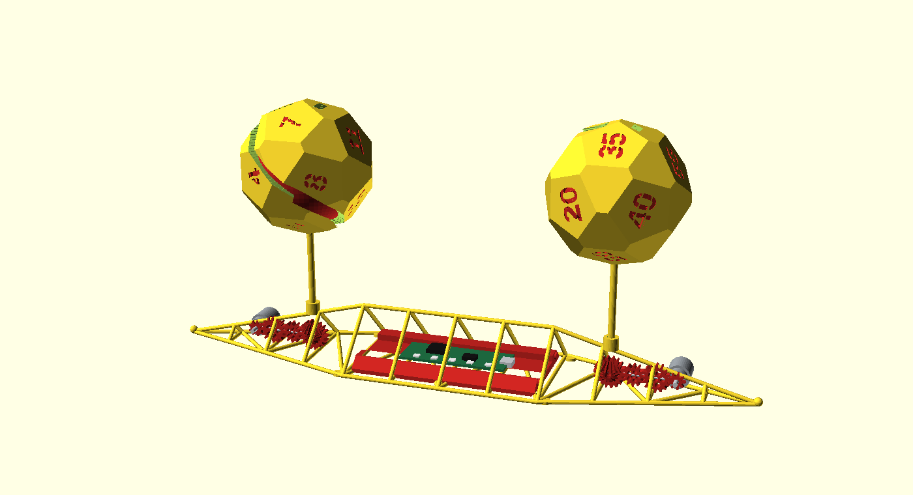
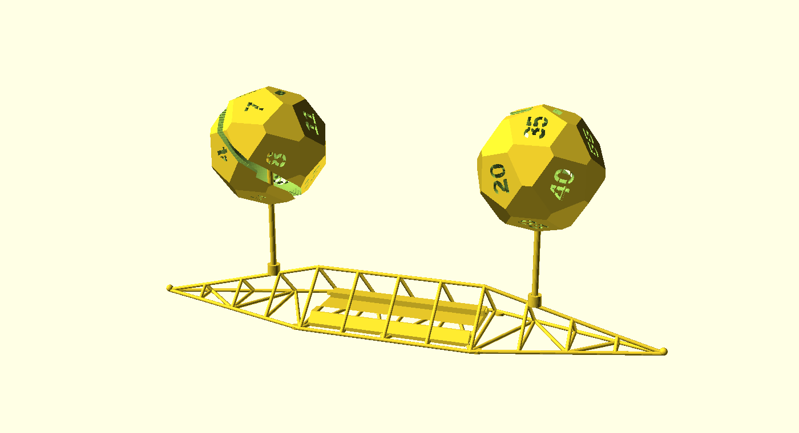
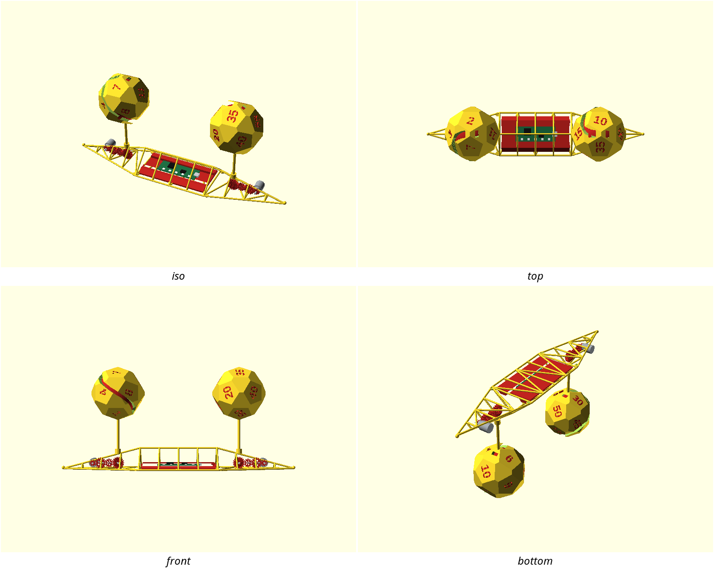
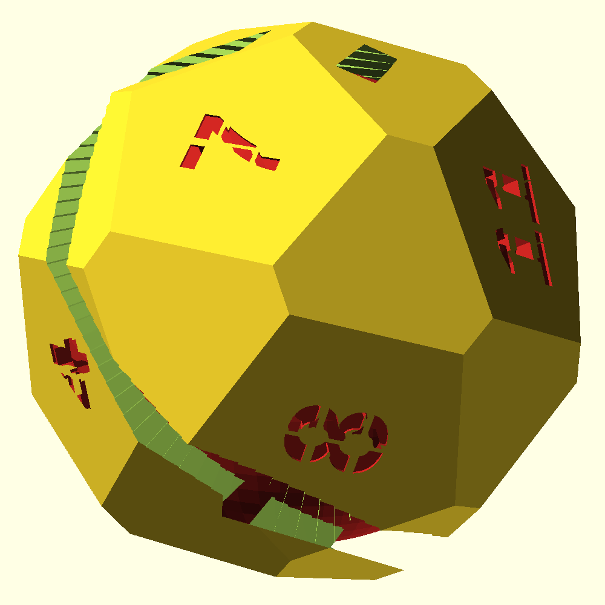
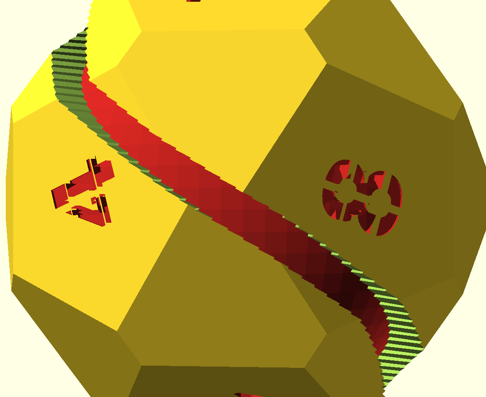
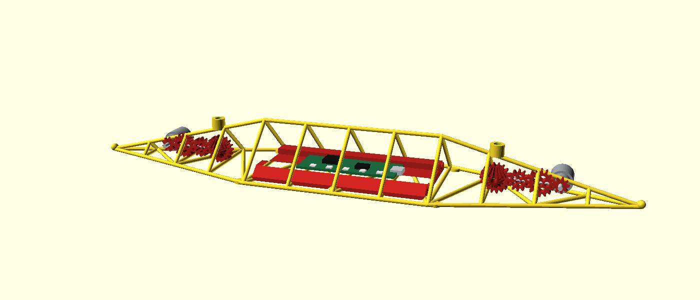

# ovodyo — kinetic dice-ball clock

A desk clock that tells the time on two slowly tumbling faceted balls: the left
ball shows the hour, the right ball the minutes in five-minute steps, each number
sitting on one of twelve pentagon plaques. A helical slot cut through each shell
frames the gears inside, so the mechanism is the ornament. This is a clean-room
re-creation, in print-bench, of the "ovodyo" clock by Mectolab — built as a
**v0 base** the improvement backlog ([#599](https://github.com/shaiss/print-bench/issues/599)) refines.

> **v0 — a working substrate, not the finished clock.** The geometry renders,
> gates and slices, and the signature look is here: chunky faceted dice-balls
> (chamfered dodecahedra — twelve flush pentagon faces plus hexagonal corner
> facets at the default `facet`), **bold numerals cut clean through** each shell to a red interior
> (stencilised so no counter drops out), and the reference's **exposed gearing in
> the base** — a geared stepper and reduction gear-train at each pod, a bevel
> take-off up each stalk, and a central electronics bay. The base drivetrain and
> the red interior are shown as **preview-only coloured parts** (a single-material
> print is one colour; the two colours are the intent — in plastic the numerals
> and slot read as **dark cut-outs**, not red; the two-tone needs the red
> interior that does not ship in v0). The balls now screw
> together on a **captive threaded seam** ([#602](https://github.com/shaiss/print-bench/issues/602)) and the base carries a **red
> structural core** — a ballast keel with sealed shot pockets ([#603](https://github.com/shaiss/print-bench/issues/603)). Several
> things are still deliberately simplified and tracked as issues: the base gears
> *represent* the drive but aren't a real meshing involute differential; there is
> no reusable space-frame library ([#604](https://github.com/shaiss/print-bench/issues/604)); the
> **ball-side stalk hub/socket** (the brass rod seats in the base today; a printed
> socket in the ball half is [#604](https://github.com/shaiss/print-bench/issues/604) with the real drive); the slot isn't yet a tunable brand
> module ([#601](https://github.com/shaiss/print-bench/issues/601)); the CoG/tip-over
> check now runs from `ci.cog` as an **advisory WARN** (it does not fail the gate).
> The first gate emit on tip `d8d9cf5` measured **STABLE** (38.28 mm clearance
> under solid-mesh PLA 1.24, which over-masses the balls vs 15–20 % infill) —
> that is one measured tip, not a promise the clock stays STABLE after a later
> change. ≈55 g of shot remains a **starting fill**; if a run says TIP-RISK,
> follow the care playbook in NOTES.md rather than treating STABLE as a claim.
> There's no committed two-tone reveal render yet ([#600](https://github.com/shaiss/print-bench/issues/600)). See NOTES.md.
>
> **Desk space:** the base alone is **383 mm**. v0 display (balls pole-flat in
> front of the base — see the what-ships shot) keeps that length and needs about
> **~20 cm of depth** and **~8 cm tall**. The **40 cm clear desk + ~17 cm
> headroom** figure is the post-[#604](https://github.com/shaiss/print-bench/issues/604) stalk clock (balls at ~124 mm
> centres, ~163 mm overall).

*Stalk-to-ball join in the hero is preview-only until [#604](https://github.com/shaiss/print-bench/issues/604) — the printable halves have no pole socket yet. Red in these previews is OpenSCAD cut/working-part colour — a single-material print is one colour.*

*What a single-material print looks like (OpenSCAD default yellow). Shells with
void numerals and the bare truss; no gear theatre. Green inside the cuts is the
renderer's inside-face colour, not a second filament. Balls sit on their pole
pentagons in front of the base (clear of the wing tips), the interim display
until [#604](https://github.com/shaiss/print-bench/issues/604) lands a retained mount. The two-tone hero above is the intent.*

*Preview-only gears seated in the lattice — scale and home for the identity shot
(`base-mech` is the close-up without the truss).*

## What you get

The printable parts (the assembled render is a preview only — a single STL of the
whole clock would print as one fused lump):

- `hours-top` + `hours-bottom` — the two halves of the ~78 mm hours ball. It is
  split **pole-up** through the triangle band, so no number face is cut by the
  seam: the top carries **2, 7, 5, 9, 11, 3** and the bottom **6, 1, 8, 4, 12,
  10** (the split follows the tumble stop table, not an even/odd rule — see
  NOTES.md). Print one of each for a complete hours ball.
- `minutes-top` + `minutes-bottom` — likewise for the minutes ball: top **10,
  35, 25, 45, 55, 15**, bottom **30, 05, 40, 20, 00, 50** (00–55 in 5s). Until
  the drive lands ([#604](https://github.com/shaiss/print-bench/issues/604)), it's a **desk die you set by hand** —
  tumble until the face you want parks on a flat pentagon — not yet a running
  clock face.
- `base-segment` — the constant-section **centre** truss segment (~127 mm).
- `base-end` — one of the two **tapering end wings** that come to a needle point
  (a Ø5.6 mm round nose) and carry a bored stalk boss over the motor pod, with
  two small recessed foot pads under the wide end for stick-on bumpers (print
  two; three segments total make the ~383 mm base).
- `base-core` — the **red structural core**: a slim ballast keel that slides
  into the centre segment and drops onto the deck struts (its underside is the
  lattice's negative, so it seats one way only) under the PCB, with two sealed
  pockets you fill with ~55 g of Ø2 mm steel shot through the plugged ports on
  its end face. Print it in red — it is a working part.
- `base-plug` — the tapered plug that closes each ballast port (print two).

The printable deliverable is the **multi-object plate**, `build/ovodyo-plate.3mf`
(built by `./scripts/plate.sh ovodyo` from `ci.plate`): the eight production
parts as eight separate objects a slicer imports as parts — duplicate `base-end`
and `base-plug` in the slicer to print two of each. On a **256 mm bed**, plan on
**two plates**: the four ball halves alone (they pack 2×2 with shared settings —
the long plate), then segment + both ends + core + both plugs on a second plate
with margin (the coffee-break plate).
- `mock-drive` — a single representative reduction gear, kept as a gated
  printability sample of the (otherwise preview-only) drivetrain. It is not a
  placed assembly part and is not included on the production plate.

The base drivetrain (gear-trains, steppers, bevels, PCB) and the balls' red
interior are **preview-only** — colours are ignored on STL export, so they are
not printable parts. See them assembled in the hero image and the
`base-mech-in-situ` gallery preview (drivetrain seated in the truss; `base-mech`
is the close-up with no lattice). Select a part with `-D 'part="hours-top"'`
(or `base-mech` / `base-mech-in-situ` / `pod-drive` to preview the mechanism);
the default render is the assembled clock.

## Print settings

- **Material:** PLA (white shell + red interior/mechanism is the intent; v0 is
  single-material).
- **Layer height:** 0.2 mm for the base parts; **0.16 mm for the four ball
  halves** — the near-pole facets sit ~52° and a finer step softens the show
  surface. A faint texture band around each pole (and slightly translucent
  lines along facet edges) is the known [#600](https://github.com/shaiss/print-bench/issues/600) caveat, not a slicing
  mistake — don't chase it with supports.
- **Infill:** 15–20 %.
- **Supports:** none. The truss and mock drive print support-free, and the
  ball halves print **pole-down** (see Orientation), which makes the cavity an
  open bowl and keeps every facet and the seam ring's 45° thread flanks
  support-free. The halves' printcheck caveats are **by-design underside
  texture** on the chamfer facets ringing the pole — they sit ~52° off-axis
  when pole-down and print with slight droop, no support — so **keep
  auto-supports off**, or the slicer fills the open bowl and welds the seam
  ring (the captive thread) shut. The slot's rims bridge ~10 mm in PLA —
  slightly drooled strips inside the window are the print, not a defect
  (turning supports on to "fix" them is the weld-the-seam failure mode).
- **Brim:** safe on every part — if the truss tips lift, turn the brim on.
  No fit on this design touches the bed (the seam rings print at the top of
  the pole-down halves; the core sockets exit vertical faces).
- **Orientation:** ball halves **pole-down** — the flat pole pentagon is the
  first layer and the seam ring is the top of the print (as the parts render).
  The pole face carries a numeral, so **layer 1 is the stencil itself**; the
  tied counters (0/4/6/8/9) are expected — keep going. Truss segments
  bottom-chord-down (as modeled); mock drive flat; the seam coupon as rendered;
  core keel flat-bottom-down; plug head-down.
- **Seam (slicer):** the stock *Aligned* seam stacks a visible z-ridge down the
  ≥6 mm mating annulus. Paint the seam onto the helical-slot interruption, or set
  **Back** or **Random**, so the closed join reads as one fine line.
- **Vitamins for the base:** two brass rods ~120 mm long for the support stalks
  (boss bore is Ø4.9 mm from `stalk_d=4.5` + 0.4 clearance). Shelf stock jumps
  4→5 mm: **bless Ø4 mm rod + a wrap of tape** (tool-free snug); ream-to-Ø5 is
  the alternative if you prefer. Length ≈ `ball_center_z −` wing height. Also
  Ø2 mm steel shot for the core's ballast pockets (**≈ 55 g is a starting fill
  you may need to adjust** — `ci.cog` runs the advisory CoG/tip-over check;
  TIP-RISK is a WARN, not a gate failure). The first emit on tip `d8d9cf5`
  measured STABLE (38.28 mm clearance); this page still does not claim the clock
  is STABLE for every future change. If a later sticky or `cog-check.sh` line
  says **TIP-RISK**, the usable next steps are in NOTES.md **TIP-RISK care**
  (read that CoG table, add ~5 g split across both pockets if they are not
  already packed, re-read the WARN — do not change the truss). Fill and plug
  **before** the core goes in, plus four Ø5 mm × 1.5 mm hemispherical stick-on
  silicone bumpers for the foot recesses.

## Parameters

The handful most worth tuning (all at the top of `ovodyo.scad`, grouped in
Customizer sections; override with `-D 'name=value'`):

| Parameter | Default | What it does |
|---|---|---|
| `ball_d` | 78 mm | ball outer diameter (across the pentagon faces) |
| `wall` | 2.2 mm | shell wall thickness at the pentagon faces |
| `glyph_h` | 14 mm | numeral height (bold, near the pentagon inradius) |
| `numerals_through` | true | cut numbers clean through to the red interior; false = debossed recess |
| `bridge_w` | 1.2 mm | stencil bridge width — the ties that keep 0/4/6/8/9 counters attached |
| `slot_width` | 10 mm | helical mechanism-window width |
| `slot_turns` | 0.5 | how far the slot wraps |
| `seam_tol` | 0.25 mm | radial clearance of the captive threaded seam — the one fit to tune; print the seam coupon first and step it by 0.05 (bigger = looser) |
| `seg_len` | 127 mm | one base-segment length (×3 = 383 mm) |
| `core_fit` | 0.3 mm | radial clearance of the core's strut sockets — tune on your printer so the keel drops onto the deck without rattling |
| `core_len` | 120 mm | length of the red core keel inside the centre segment |
| `tip_d` | 5.6 mm | round nose at each wing tip (2 × `strut_d`) |
| `foot_recess_d` | 4.9 mm | foot-pad recess, sized to a Ø5 mm stick-on bumper |

**Font note (source re-renders):** the numerals currently use OpenSCAD
`text(font="Liberation Sans:style=Bold")`. CI and the committed STLs resolve
that face; a machine without Liberation Sans only WARNs and falls back, so
glyph outlines can drift while the stencil bridges stay put. Install Liberation
Sans before re-rendering from source — or wait for [#601](https://github.com/shaiss/print-bench/issues/601)/[#612](https://github.com/shaiss/print-bench/issues/612),
which swap to font-free `lib/stencil-glyphs.scad`.

The ball's faceting is `facet` in `ovodyo.scad` (default 1.05). Measured on the
corrected corner normals ([#768](https://github.com/shaiss/print-bench/issues/768)):
**1.0** → deepest cut (12 pentagons + 20 hexagons, max radius ≈ 42.3 mm at
`ball_d=78`); **1.05** (default) → dominant pentagon plaques with hexagonal
corners (max radius ≈ 44.0 mm); **≈1.098** → regular icosidodecahedron (12
pentagons + 20 triangles); **>1.098** → truncated dodecahedron (decagon plaques
— avoid, the numerals lose their pentagon face); **≥1.2584** → plain
dodecahedron.

## Assembly & use

**v0 prints, screws together and stands; it does not yet move or tell time on
its own** — the printed drive interface is [#604](https://github.com/shaiss/print-bench/issues/604).

Print a **top and a bottom half** per ball (they carry different numbers) and
**screw them together** around the equator: the bottom half carries a short
threaded ring standing up from its flat seam face, the top half the matching
thread inside its rim. Line the facets up, drop the top half on — it only
enters at that one clocking — and turn it **exactly one full turn** until the
flat faces meet; the facets line up again as they close and the seam reads as
one fine line. No glue, no dowels, and it unscrews the same way to reach the
mechanism. **Print the seam coupon first** (`ovodyo-coupon.scad`: a male ring
and a female puck side by side; the strip is **164 mm wide — needs a ≥170 mm
bed**) and tune `seam_tol` in 0.05 mm steps until the puck runs on by hand with
light drag and seats without rattle — then render the halves with that value. If
the coupon's male ring feels tight only at the very start of the turn, that's
**first-layer squish on the coupon**, not the fit — don't loosen `seam_tol` for
it; the production seam never touches the bed.

**Stalks (v0 display):** seat **Ø4 mm brass rods + a tape shim** (or reamed Ø5)
in the Ø4.9 mm `base-end` bosses — snug is right; don't ream unless you chose
the Ø5 path. The **ball halves have no printed pole socket yet** — the hero
preview unions a cylinder into the shell that no printable part carries. Until
the hub lands in [#604](https://github.com/shaiss/print-bench/issues/604), stand each assembled ball on its flat pole
pentagon beside the base, or rest it on the rod tip without claiming a retained
mount (there is no v0 "running feel" to tune — that fit is #604's). The shells are light and will roll off a hard desk — put a dab of museum putty
on a facet *rim* (not across the cut-through numeral — putty in a void is hard
to pick out) until #604, or keep them where a fall lands soft. The three
truss segments join end to end (printed bolt/flange joints are [#603](https://github.com/shaiss/print-bench/issues/603);
tape or a dab of glue holds a temporary join — place the assembly before the
pour, and lift from the centre segment so the taped ends don't peel).

**The red core goes in before the clock stands up, and the order matters: 1. fill
each ballast pocket with Ø2 mm steel shot → 2. wedge a `base-plug` into each port
→ 3. slide the keel into the centre segment** until it drops onto the deck struts
(it seats one way only). Fill and plug *before* you slide — a seated keel has no
port access. Print the plugs on the coffee-break plate with the other base parts,
never solo (a Ø5 mm part is easy to lose; a spare is cheap insurance). Weigh the
pour first (~55 g total starting fill); pour in **~10 g stages and tap between
stages** (tapping while pouring fights the funnel). A folded-paper funnel with
the tip cut to ~3 mm keeps shot off the desk — the Ø3.2 mm port is only about
one and a half pellets wide, so shot will jam and arch. Press a Ø5 mm silicone
bumper into each of the four foot recesses.

**Heft (v0 interim):** the shells are light for their size — the reference's
mass lives in the drive that [#604](https://github.com/shaiss/print-bench/issues/604) brings. A **packed** pour of shot
wrapped in felt (or similar) inside a ball half before you screw it shut is a
fine interim heft hack — keep the pack against the seam, away from the numeral
faces (the cuts are windows; a dark wrap shows less), and know a one-sided lump
can bias which face parks. **Loose shot is forbidden** — it rattles against the
numeral voids, and on this page rattle reads as broken. The heft arrives properly
with the drive.

**Care:** cut-through numerals, the 10 mm slot, and the airy truss collect desk
dust — unscrew a ball (one full turn) and wipe the cavity when it looks dull;
dust the lattice with a soft brush. Rotate which numeral faces the desk under
the putty dab so wear doesn't pick one face forever.

The real
clock is driven by a geared stepper through a bevel differential and homed with a
hall sensor — the drivetrain here is a preview representation and the electronics
are out of scope for this geometry v0; the printed drive interface (a hub in the
ball, an index that lands a face upright, a real meshing differential) is the
mechanical work tracked in [#600](https://github.com/shaiss/print-bench/issues/600)/[#604](https://github.com/shaiss/print-bench/issues/604). See NOTES.md and the backlog.
