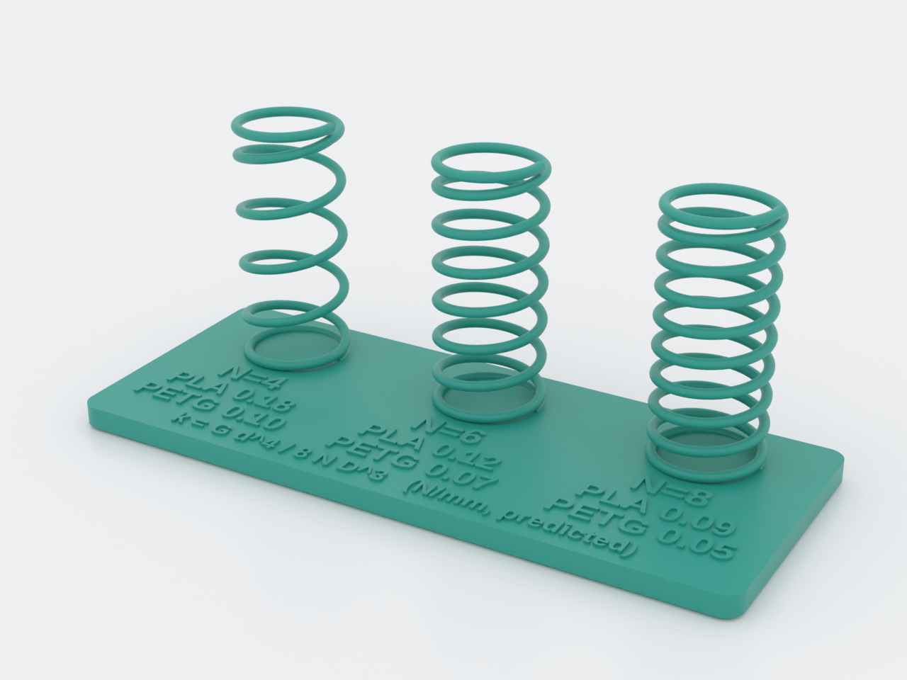
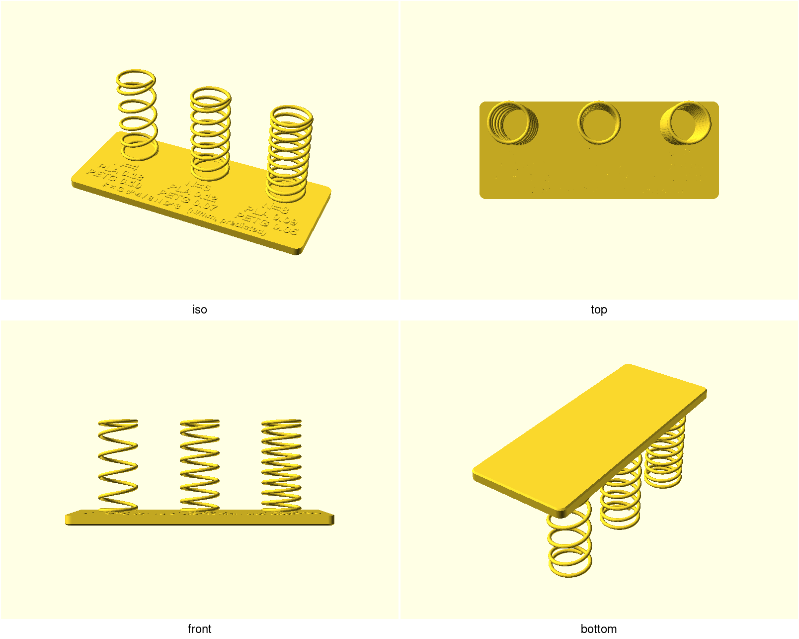
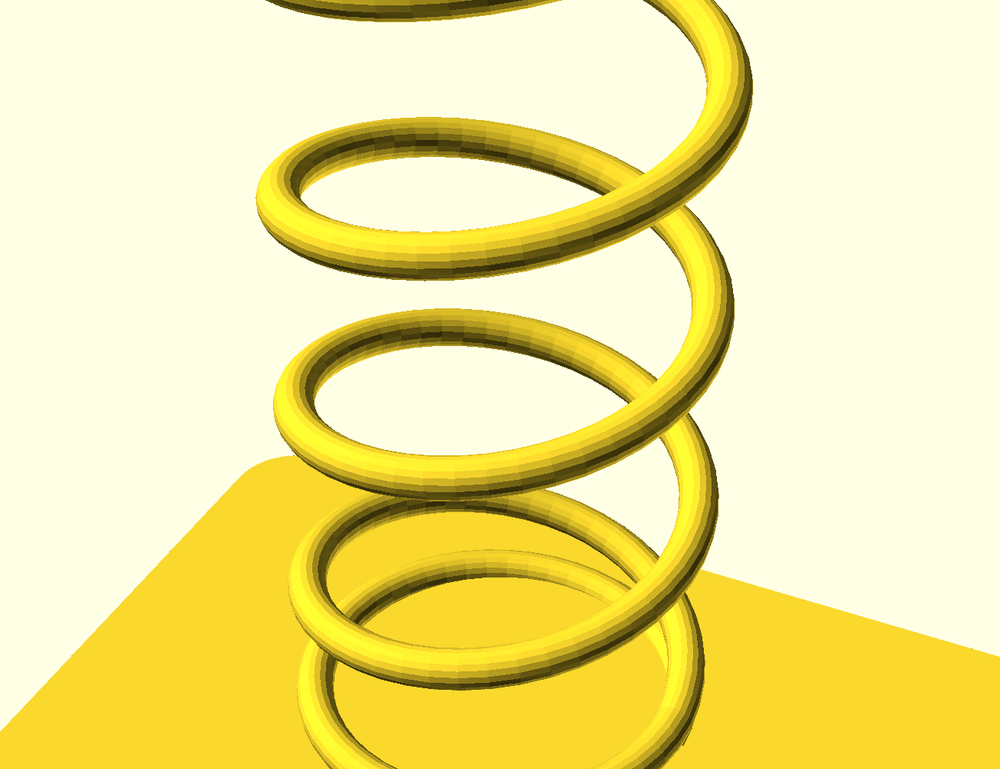
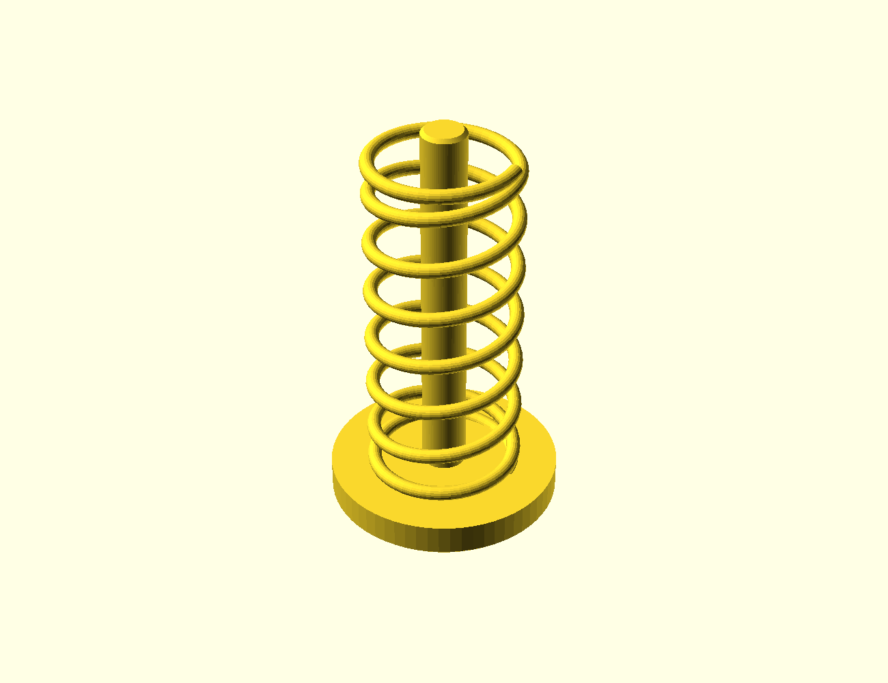
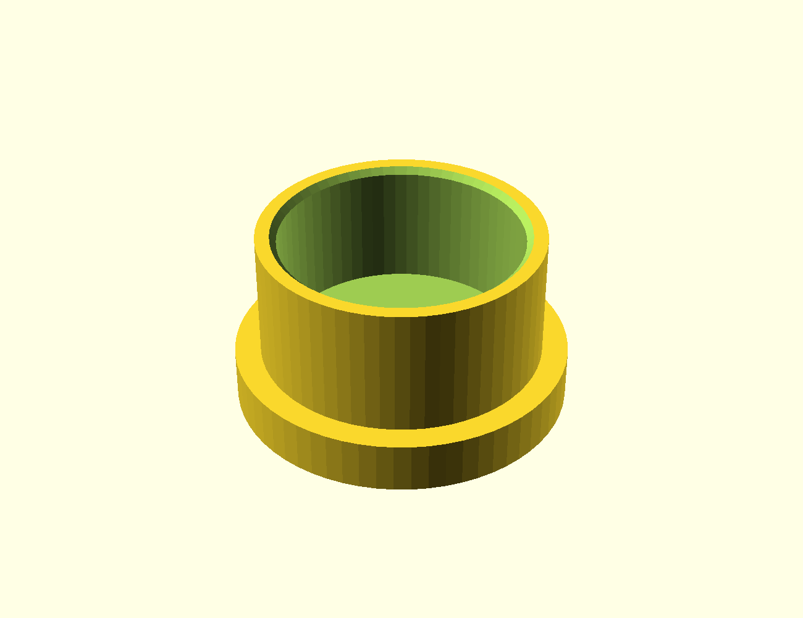

# spring-rate-ladder

Three printed helical compression springs on one baseplate, each with its
**predicted spring rate embossed beside it** — a physical k-probe for anyone
designing a compliant mechanism in printed plastic. Literature shear moduli
vary ±20 %, which is exactly the uncertainty this part removes: measure what
*your* filament actually does, back out its effective G, and design against a
number instead of a guess. The rates halve as coil count rises — k ∝ 1/N reads
straight off the plate.

## What you get

- `ladder` — one baseplate (108 × 44 × 44 mm) carrying three springs that
  differ **only** in active-coil count N = 4 / 6 / 8, each with its predicted
  PLA and PETG rate embossed on the plate (wire Ø 1.6 mm, coil mean Ø 16 mm,
  free length 40 mm). Prints without supports; expect a slightly flattened
  underside on the wire (the wraps rest approximately on the turn below —
  not a perfect round section), which the coupon's measurement absorbs.
- `coupon` — the measurement rig: a Ø26 pad, a guide post, and one N=6 spring
  (26 × 26 × 46 mm).
- `cap` — the guided press cap for the coupon (Ø26 × 14 mm): its skirt clears
  the spring OD while the centre hole rides the post, so the force you apply
  stays axial.

The embossed predictions (k in N/mm): N=4 — PLA 0.18 / PETG 0.10; N=6 —
0.12 / 0.07; N=8 — 0.09 / 0.05. They are computed inside the `.scad` from the
same parameters that build the geometry, so the plate can never state a number
the mesh didn't produce.

## Print settings

- **Material:** PLA or PETG — measuring the difference between them is half
  the point. Springs live or die by layer adhesion: PETG slow-cooled, PLA
  with plenty of part cooling. On PETG, start `post_clearance` at **0.8**
  (the default 0.6 is sized for PLA; PETG first-layer squish closes the post
  hole faster).
- **Layer height:** 0.2 mm (the embossing is exactly two layers; the closed
  end-coil weld assumes ≤ 0.2).
- **Wall width:** 0.40 mm — k ∝ d⁴ is the whole story, so the 1.6 mm wire
  must print as four solid perimeters (4 × 0.40 = 1.60). Stock Bambu 0.42 mm
  walls leave a gap-filled not-quite-solid wire.
- **Seam:** back or scarf — a random seam on a thin moving coil is a weak
  spot every turn.
- **Infill:** any (the plate is 4 mm solid-ish; perimeters matter more).
- **Supports:** none needed — the coil climbs at a 5–10° lead angle, so each
  wrap rests approximately on the one below. Expect a slightly flattened
  wire underside; the coupon measures the as-printed section.
- **Orientation:** as modelled. Ladder plate-down, coupon pad-down, and the
  **cap disc-down** (the `cap` part is already modelled flipped for this — a
  cup, so its bearing face is a first-layer surface and nothing bridges). The
  post-hole mouth on that disc face has a 0.4 mm 45° chamfer so first-layer
  squish cannot eat the 0.3 mm radial clearance.
- **Do not thin the wire:** k ∝ d⁴, so one perimeter of squish on the 1.6 mm
  wire is a measurable rate change. Print the wire at full 0.40 mm wall width.

## Parameters

| Parameter | Default | What it does |
|---|---|---|
| `d_wire` | 1.6 mm | wire diameter — the k ∝ d⁴ knob (2.0 mm is the escalation if your printer facets the coil) |
| `d_mean` | 16 mm | coil mean diameter (index D/d = 10) |
| `l_free` | 40 mm | free length (wire-centreline to wire-centreline) |
| `ladder_ns` | [4, 6, 8] | active coils per station — the one variable the ladder compares |
| `G_pla` / `G_petg` | 3500 / 1950 MPa | shear moduli the embossed predictions use — literature values; the coupon measures yours |
| `coupon_n` | 6 | active coils on the coupon spring (matches the middle station) |
| `cap_spring_clearance` | 1.2 mm | cap skirt clearance over the spring OD (on the diameter) |
| `post_clearance` | 0.6 mm | cap centre-hole clearance over the guide post (on the diameter); start at 0.8 for PETG |

All parameters are at the top of `spring-rate-ladder.scad`, grouped in
Customizer sections; override on the command line with
`-D 'd_wire=2.0'`.

## Assembly & use — measuring your filament's G

1. Print the `coupon` **and** the `cap` in one slicer session (they only work
   as a pair). Seat the cap: skirt over the spring, centre hole down the
   post. It should slide down the post and rest on the spring under its own
   weight; if the post hole binds, raise `post_clearance` in +0.2 steps
   (PETG: start at 0.8); if the skirt scrapes the coils, raise
   `cap_spring_clearance`.
2. Zero a kitchen scale with the rig on it. Your scale must resolve single
   grams (1 g ⇒ ~0.01 N — coarser and the slope is noise). Press the cap and
   at each stop read **force in grams** and **deflection at the post tip**:
   with a caliper, measure how far the post tip sits above the disc top
   (at rest the tip is about 2 mm *below* the disc face — record that as
   your zero). Deflection
   **x = (tip-above-disc when pressed) − (tip-above-disc at rest)**.
   Take a few points — say 5 / 10 / 15 / 20 mm. Convert force:
   **F [N] = reading [g] × 0.00981**. The slope of F(x) is your measured k
   (N = 6).
3. Back out your filament's effective shear modulus:
   **G = 8·N·D³·k / d⁴** (lengths in mm, k in N/mm → G in MPa).
   Worked example (N=6 PLA, one point on the line): 122 g at 10 mm →
   F = 122 × 0.00981 ≈ 1.20 N → k ≈ 0.12 N/mm →
   G = 8·6·16³·0.12 / 1.6⁴ ≈ 3600 MPa. If you compute ~350,000, you
   plugged grams in as newtons.
4. Log it as a FIELD-TEST entry (`templates/FIELD-TEST.md`).
   `printer.conf` write-back of G is planned (B3) — the profile has no G
   field yet.

**Care.** Stop pressing the coupon around 25–30 mm — full solid on the N=6
coupon sits at the bottom edge of the PLA shear-yield band and a taken-set
spring silently biases every later G. Store the cap **off** the spring
between sessions (a seated cap is a creep fixture).

Honesty note, because the plate's own footer says *predicted*: fully
compressed to solid, the Wahl-corrected torsional stress is ≈ 61 / 36 / 24 MPa
(PLA) and ≈ 34 / 20 / 13 MPa (PETG) for N = 4/6/8. PLA's shear yield is
~35–45 MPa in the literature, so the N=4 station pressed flat in PLA sits
past it and will likely take set — measure, don't over-press. Lower G is
protective: force at solid scales with k.

