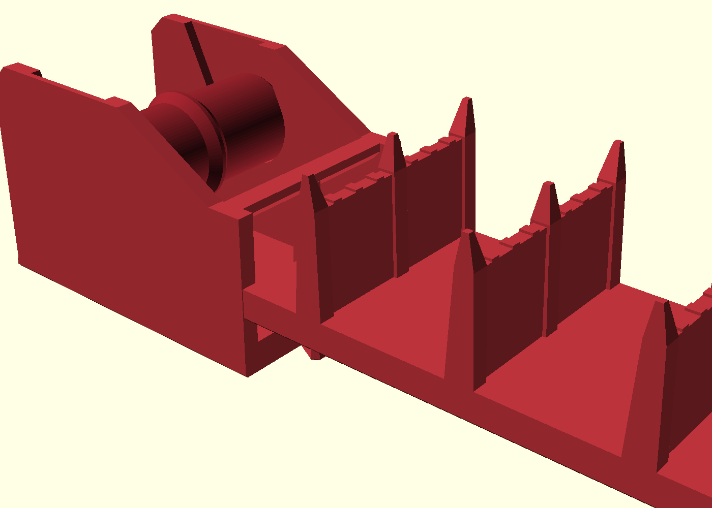
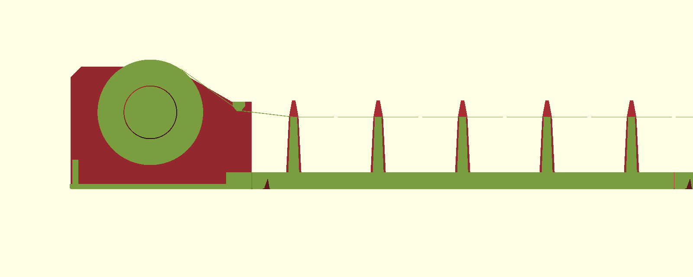

# tape-strip-rack — eighteen tape strips from one pull

A desk rack for wrapping a pile of gifts. Pull two tapes once along a row of fins, snip between the fins with scissors, and eighteen equal strips are left hanging by their middles — each one ready to grab with one hand while the other holds the paper. It is blade-free: nothing on it cuts, so you need scissors.

## What you get

- `cradle` — holds the spindle and both rolls, with a hold-down gate the tapes pass under (94 × 57 × 58 mm)
- `spindle` — one hub for two rolls on a 1 in (25.4 mm) core (Ø 29 × 53 mm)
- `rack` — five fins at a 40 mm pitch; print it twice for ten fins (208 × 57 × 42 mm)
- `end-cap` — closes the last joint and gives the two tape tails a ledge to stick to (31 × 57 × 42 mm)
- `tape-strip-rack-coupon` — the print-this-first joint coupon (33 minutes, 7 g)

The parts print separately. The file to slice is the multi-object plate, `build/tape-strip-rack-plate.3mf`: four separate objects, each already in its print orientation. One of each is a complete five-fin rack (eight strips a pull). Duplicate `rack` in your slicer, or print it again, for the ten fins shown here.

## Print settings

- **Material:** PLA
- **Layer height:** 0.2 mm, 0.4 mm nozzle
- **Perimeters:** 3
- **Infill:** 15–20 %
- **Supports:** none, and leave them off. The gate on the cradle is two 22 mm bridges, which is what it is meant to be
- **Orientation:** as exported. Cradle, rack and end cap sit on their bases; the spindle stands on end
- **Bed:** every part fits 220 × 220 mm. The rack is 208 mm long
- **Filament and time** (PrusaSlicer's own defaults, which are slow): about 232 g and 19 hours for the ten-fin set; a rack segment alone is 76 g and 6 hours
- **Print the joint coupon first** (below)

Nothing here has been printed yet. The geometry passes the repo's printability gate and a test-slice; the fits are calculated, not field-tested.

## Print this first: the joint

The parts join with a drop-in dovetail, and its clearance is the one fit worth tuning to your printer.

1. Print `tape-strip-rack-coupon.scad`. It gives you a key stub and a socket stub.
2. Lower the socket stub onto the key stub. It should drop on under light finger pressure. Lift the key stub: the socket stub should come up with it.
3. Too tight: raise `joint_clear` by 0.05 mm and reprint the coupon. Rattles: lower it by 0.05.
4. Print the plate at the value that worked.

Measure the core of your own tape roll as well. `core_id` assumes 25.4 mm.

## Parameters

| Parameter | Default | What it does |
|---|---|---|
| `strip_len` | 40 mm | strip length, which is the fin pitch. 50 gives 2 in strips; set `fins_per_rack = 4` with it to stay on a 220 mm bed |
| `fins_per_rack` | 5 | fins on one rack segment |
| `tape_w` | 19 mm | tape width; 12 to 25 |
| `core_id` | 25.4 mm | inner diameter of the roll's core |
| `roll_od_max` | 62 mm | largest roll the cradle clears |
| `joint_clear` | 0.2 mm | clearance in the dovetail, each face. The coupon tunes this |
| `land_ribs` | 3 | ribs per lane on each fin top. Fewer makes a strip easier to peel; 0 makes the top flat, for tape that will not stay put |
| `fin_h` | 26 mm | height of the tape above the base: room for scissors and fingers |
| `lanes` | 2 | rolls side by side. One lane needs a narrower joint; the render stops and says so |

All parameters are at the top of `tape-strip-rack.scad`, grouped in Customizer sections; override on the command line with `-D 'strip_len=50'`. The fit proofs and the cutaway are selected with `part`.

## Assembly & use

**Assemble.** Stand the cradle on the table. Lower a rack onto the cradle's key, a second rack onto the first, and the end cap onto the last. To move it, pick it up by the cradle: the joints are shaped so each part carries the next. To take it apart, lift the end cap straight up, then each rack.

**Load.** Slide two rolls onto the spindle, one each side of the flange, with the tape coming off the **top** of each roll toward the rack, sticky side down. Thread each tape end under the gate, then drop the spindle into the slots in the cradle walls.

**Pull.** Hold the cradle down with one hand. Pinch both tape ends and pull them along the rack, level with the gate or a little above it, to just past the end cap. Lower them and stick the ends to the end cap's ledge. Run a finger along each lane to press the tape onto every fin.

**Cut.** Snip both tapes midway between each pair of fins, and between the last fin and the end cap. The fin nearest the rolls keeps the two tape ends for the next pull; every other fin holds one 40 mm strip per lane — nine fins, eighteen strips.

**Grab.** Take a strip by a free end and roll it off its fin.

**What it will not do.** It does not cut. It is light — about 230 g of plastic plus the rolls — so it slides when the tape is pulled unless you hold the cradle; stick-on bumper feet on the flat underside help. Changing one roll lifts both. It takes tape on a 1 in core up to 62 mm across; packing tape and 3 in cores do not fit.
