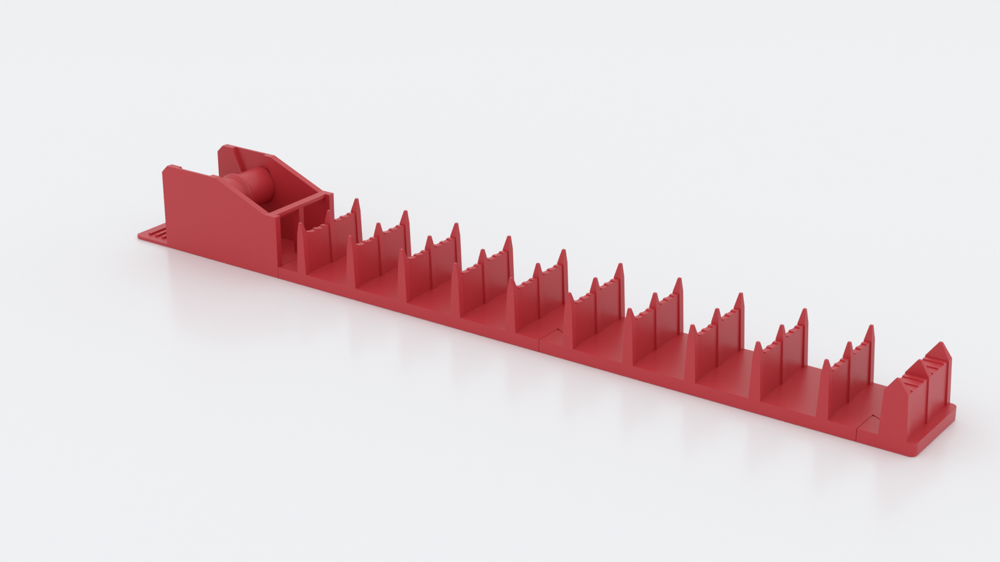
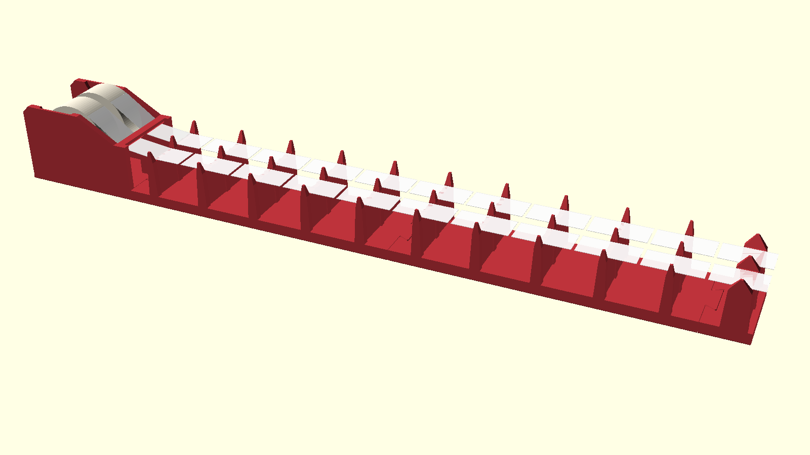
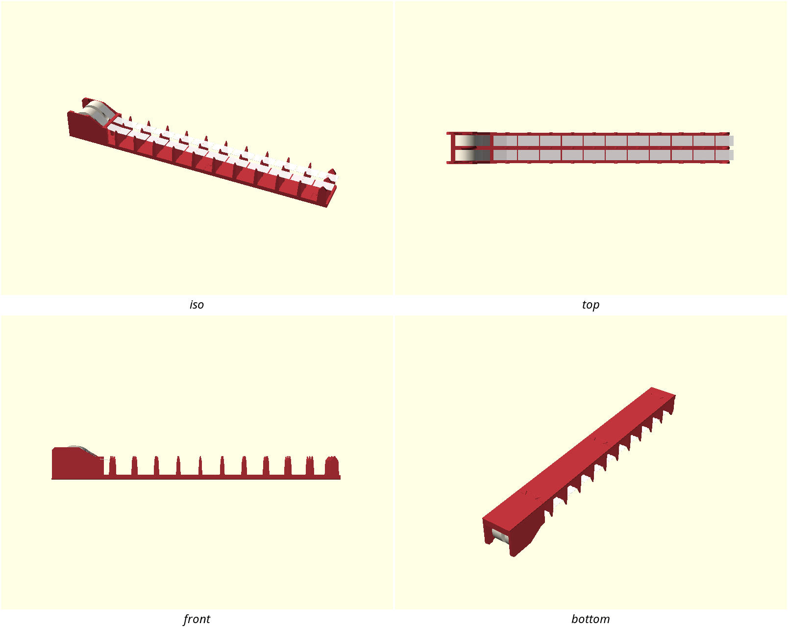
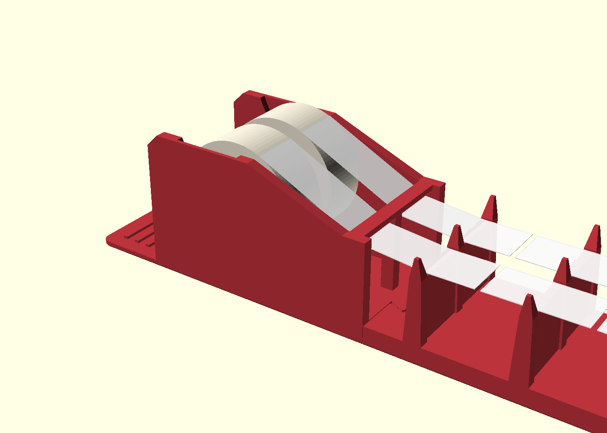
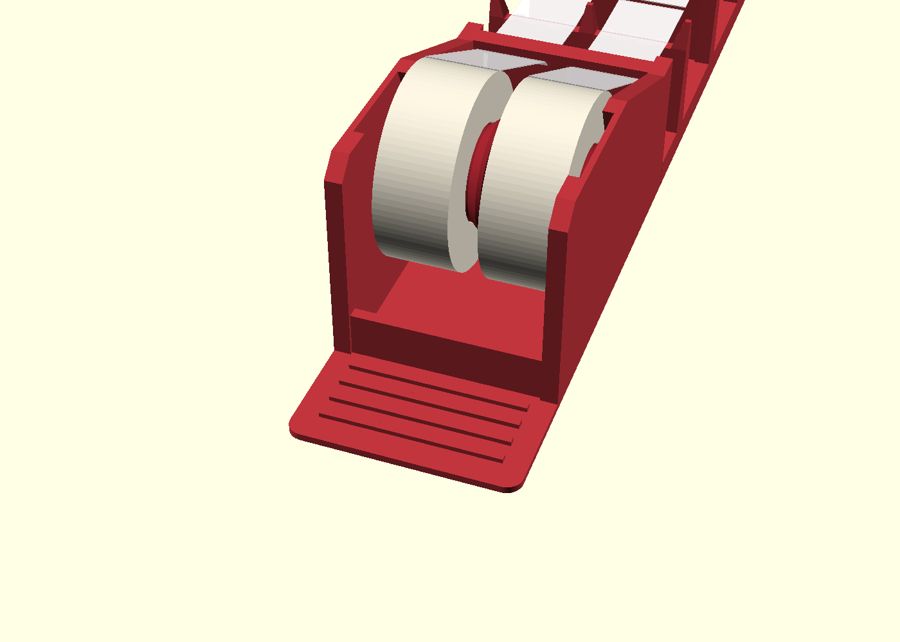
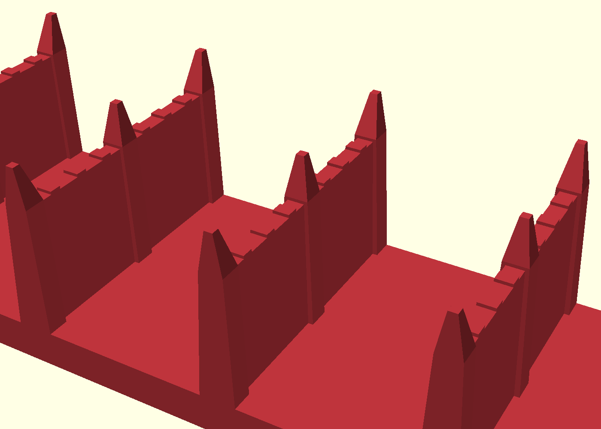
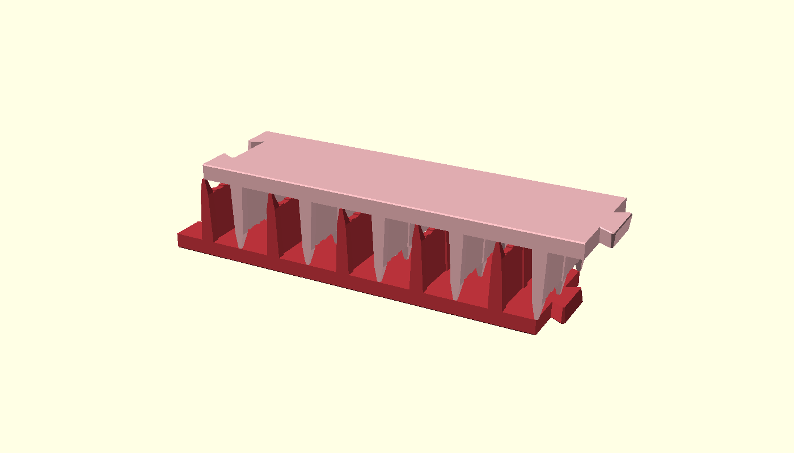

# tape-strip-rack — eighteen tape strips from one pull

A desk rack for wrapping a pile of gifts. Pull two tapes once along a row of fins, press them down, snip between the fins with scissors, and eighteen equal strips are left hanging by their middles — each one ready to grab with one hand while the other holds the paper. It is blade-free: nothing on it cuts, so you need scissors.

## What you get

- `cradle` — holds the spindle and both rolls, with a gate the tapes pass under and a palm pad behind the rolls (136 × 57 × 58 mm)
- `spindle` — one hub for two rolls on a 1 in (25.4 mm) core (Ø 29 × 52 mm)
- `rack` — five fins at a 40 mm pitch; print it twice for ten fins (208 × 57 × 42 mm)
- `end-cap` — closes the last joint and gives the two tape tails a ledge to stick to (33 × 57 × 42 mm)
- `tape-strip-rack-coupon` — the print-this-first joint coupon (44 minutes, 10 g)

The parts print separately. The file to slice is the multi-object plate, `build/tape-strip-rack-plate.3mf`: four separate objects, each already in its print orientation. Press **Arrange** after opening it; the four then fit a 220 mm bed.

The plate holds one rack, which makes a complete five-fin rack: four strips a lane, eight a pull. Print `rack` a second time for the ten fins shown here.

## Print settings

- **Material:** PLA
- **Layer height:** 0.2 mm, 0.4 mm nozzle
- **Perimeters:** 2 or 3
- **Infill:** 15–20 %
- **Supports:** none, and leave them off. The gate on the cradle is two 22 mm bridges, which is what it is meant to be
- **Orientation:** as exported. Cradle, rack and end cap sit on their bases; the spindle stands on end
- **Bed:** every part fits 220 × 220 mm, but the rack is 208 mm long and leaves 6 mm at each end. On a 220 mm bed set the skirt distance to 2 mm (or print without one), or turn the rack 45°
- **Filament and time:** about 242 g and 19 h 40 m for the ten-fin set on PrusaSlicer's own slow defaults (3 perimeters, 20 % infill); a rack segment alone is 75 g and 6 hours. Two perimeters and 15 % infill take about 18 % off the filament and 13 % off the time (198 g, 17 h 10 m). Slightly thinner fins would not help: they are already almost all perimeter
- **Print the joint coupon first** (below)

Nothing here has been printed yet. The geometry passes the repo's printability gate and a test-slice, and was checked layer by layer for anything that starts in mid-air. The fits are calculated, not field-tested.

## Print this first: the joint

The parts join with a drop-in dovetail, and its clearance is the one fit worth tuning to your printer.

1. Print `tape-strip-rack-coupon.scad`. It gives you a key stub and a socket stub.
2. Lower the socket stub onto the key stub. It should drop on under light finger pressure.
3. With both flat on the table, push and pull the socket stub along the joint. About 0.6 mm of play is right.
4. Will not go on: raise `joint_clear` by 0.05 mm and reprint. Clearly more than 1 mm of play: lower it by 0.05.
5. Print the plate at the value that worked.

Measure the core of your own tape roll as well. `core_id` assumes 25.4 mm.

## Parameters

| Parameter | Default | What it does |
|---|---|---|
| `strip_len` | 40 mm | strip length, which is the fin pitch; 40 to 60 as shipped (36 with `ledge_l = 8`; the render stops and says so). 50 gives 2 in strips and needs `fins_per_rack = 4` to stay on a 220 mm bed; 60 needs `fins_per_rack = 3` |
| `fins_per_rack` | 5 | fins on one rack segment |
| `tape_w` | 19 mm | tape width, 12 to 25. Narrower tape wants its own render, not a 19 mm print |
| `core_id` | 25.4 mm | inner diameter of the roll's core |
| `roll_od_max` | 62 mm | largest roll the cradle clears |
| `joint_clear` | 0.2 mm | clearance in the dovetail, each face. The coupon tunes this |
| `land_ribs` | 3 | ribs per lane on each fin top. Fewer makes a strip easier to peel; 0 makes the top flat, for tape that will not stay put |
| `fin_h` | 26 mm | height of the tape above the base: room for scissors and fingers |
| `heel_l` | 30 mm | length of the palm pad behind the rolls; 0 removes it |
| `lanes` | 2 | rolls side by side. One lane needs a narrower joint (`joint_neck=6`, `joint_tip=13`); the render stops and says so |

All parameters are at the top of `tape-strip-rack.scad`, grouped in Customizer sections; override on the command line, for example `-D strip_len=50 -D fins_per_rack=4`. The fit proofs and the cutaway are selected with `part`.

## Assembly & use

**Assemble, in order.** Stand the cradle on the table first. Lower a rack onto the cradle's key, a second rack onto the first, and the end cap onto the last. A part that will not go on is usually being put on in the wrong order: the key must already be on the table and the socket lowered over it. To take it apart, lift the end cap straight up, then each rack.

**Moving it.** Slide it, or carry it with a hand under the racks. The joints cannot pull apart along the rack, and lifting the cradle straight up does catch the first rack, but a rack hanging off a lifted cradle is held only by friction. Lifting a rack or the end cap leaves everything nearer the rolls on the table.

**Load.** Slide two rolls onto the spindle, one each side of the flange, with the tape coming off the **top** of each roll toward the rack, sticky side down. A roll put on backwards feeds sticky side up. Hold the rolls, not the spindle, and lower it into the slots in the cradle walls; it goes in up-and-back and comes out the same way.

**Thread.** Let each tape end drop behind the gate, fish it forward through the opening underneath, and stick it to the first fin.

**Pull.** Press down on the palm pad with one hand. With the other, take both tape ends off the first fin, a thumb across both so they stay a lane apart, and pull them along the rack above the posts to just past the end cap. Lower them between the end cap's posts and stick the ends to its ledge. The tape now hovers a millimetre or two over the fins: run a fingertip down each lane to press it onto every fin.

**Cut.** Snip both tapes midway between each pair of fins, and between the last fin and the end cap. Scissors with 60 mm blades reach across both lanes; shorter ones take one snip a lane, from either side.

**What one pull gives you.** Ten fins give nine strips a lane, eighteen a pull. The fin nearest the rolls keeps the two tape ends parked for the next pull, and the end cap's ledge keeps an odd-length tail.

**Grab.** Take a strip by a free end and roll it off its fin sideways. Hold the end cap down with a fingertip when you peel the tails off its ledge: it is the lightest part and lifts straight off.

**Store.** Two rack segments nest: turn one over, shift it half a pitch, and its fins sit in the other's gaps (228 × 57 × 50 mm for the pair).

**What it will not do.** It does not cut. With rolls it weighs about as much as two tapes pull (roughly 3 N against 2–8 N), so it slides unless you hold the palm pad; stick-on bumper feet on the flat underside help but do not replace the hand. Changing one roll lifts both. It takes tape on a 1 in core up to 62 mm across; packing tape and 3 in cores do not fit.
