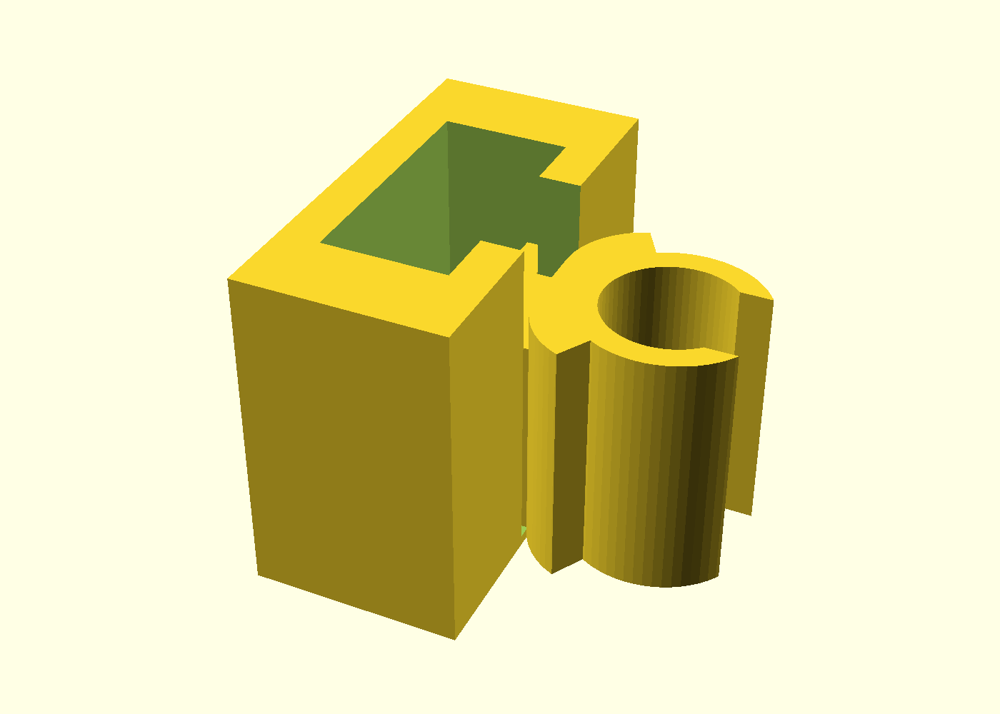
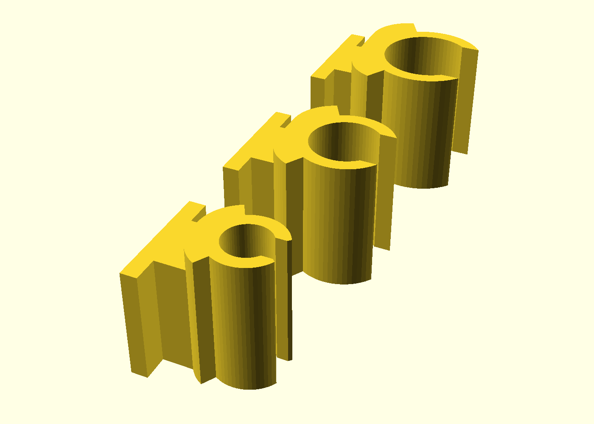
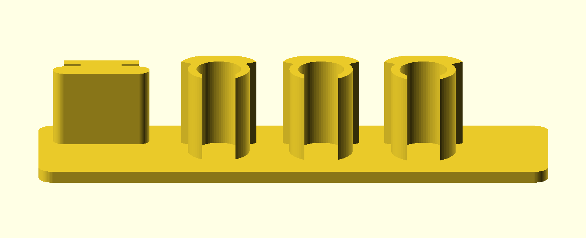
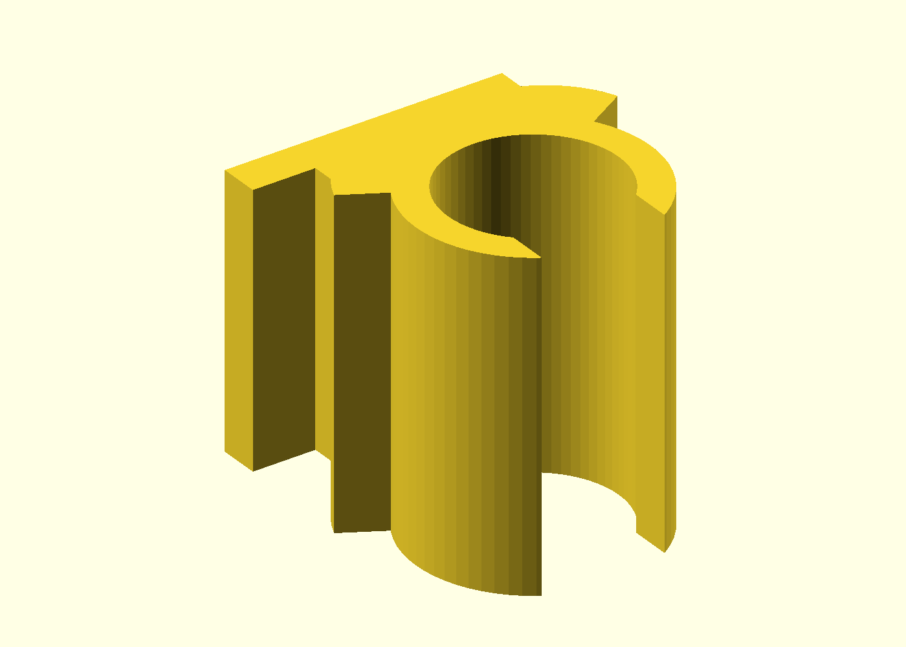
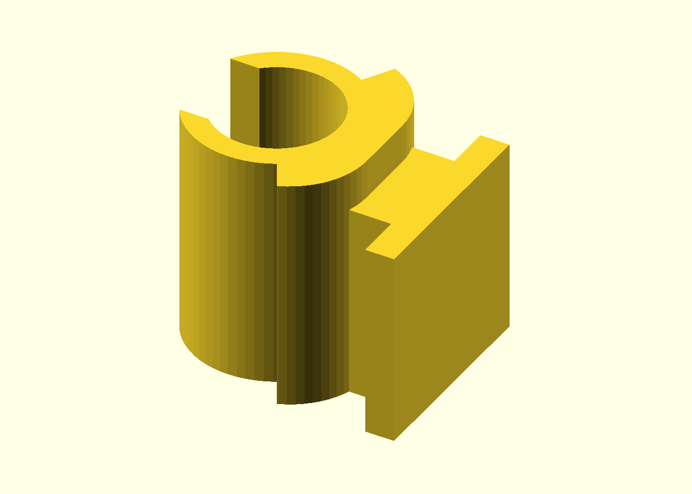
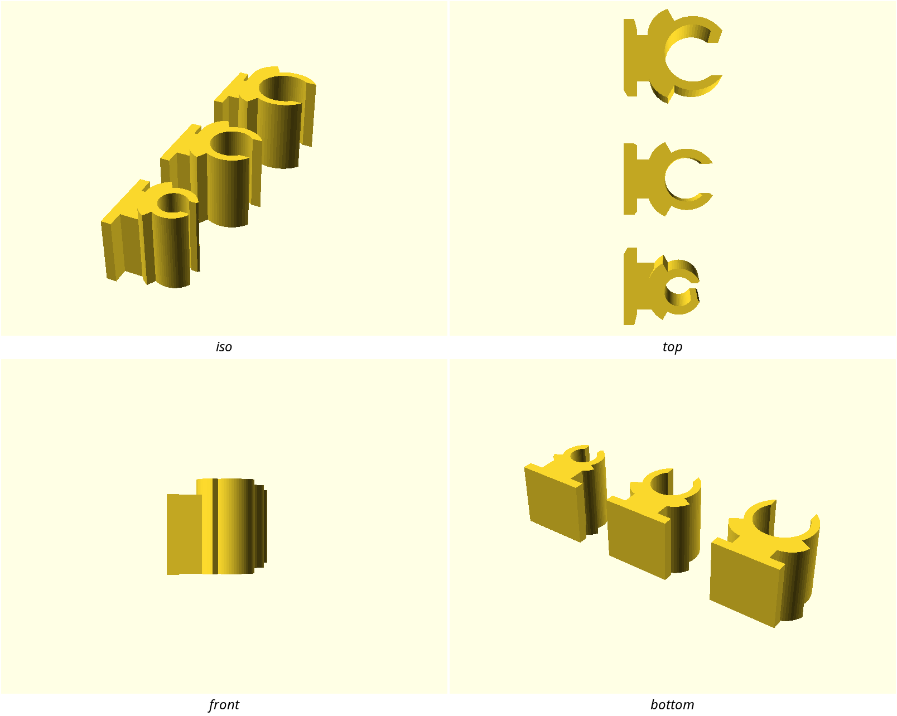

# tslot-cable-clip

Snap-in cable clips for standard 2020 T-slot aluminum extrusion: one
hammer-head lug slides into the rail's side slot and a closed snap loop
routes a cable **along** the rail — no zip ties, no adhesive, and the clip
repositions by sliding. Anyone with a 2020-frame printer, enclosure, or
workbench who is sick of cables drooping across their rails.

Three stations cover the common cable classes: Ø4 mm (PTFE Bowden,
micro-USB), Ø6.2 mm (Cat5e, USB-A), and Ø8 mm (pneumatics, small bundles).

## What you get

- `station-a` — Ø4 mm loop, ~12.5 × 9 × 12 mm
- `station-b` — Ø6.2 mm loop, ~14 × 11 × 12 mm
- `station-c` — Ø8 mm loop, ~16.5 × 13 × 12 mm
- `tslot-cable-clip-plate.3mf` — all three on one plate as **separate
  objects** (the printable deliverable; import keeps them apart)
- `coupon` — the print-this-first fit check (see below)

All three prints **as modeled, no supports**: the whole clip is a plan-view
profile extruded up from the bed, so every wall is vertical and the only
horizontal faces are the bed face and the top.

## Print settings

- **Material:** PLA fine; PETG for anything load-bearing or near heat
- **Layer height:** 0.2 mm (the flex tabs are 1.2 mm — six layers)
- **Perimeters:** 3 (the loop walls are 2.4 mm)
- **Infill:** 20–40 %, barely matters — the body is walls
- **Supports:** none — nothing overhangs
- **Orientation:** as drawn (flat face on the bed)
- **Seam:** default Aligned is fine; if your cable drags sliding through the
  bore, switch to Scarf (the seam ridge sits inside the bore)
- **Brim:** 3–4 mm on the coupon (narrow lug strip) and on station A if the
  first layer lifts

**Print the coupon first** (~35–40 min, and in the **same material** you
will print the plate in — snap feel scales with material stiffness): the
production lug on a strip of the production back, plus three production
loop sections at increasing bore clearance. Slide the lug into your real
rail and push your real cable through each loop before committing to a
plate — the tuning ladder is in `NOTES.md`.

## Parameters

The handful you are most likely to tune (all at the top of
`tslot-cable-clip.scad`, in Customizer sections):

| Parameter | Default | What it does |
|---|---|---|
| `slot_fit_tol` | 0.15 mm/side | Lug-to-slot clearance. Won't slide in your rail? Raise 0.05 at a time (6.2 mm-slot rails need ~0.20). Rattles? Lower it. |
| `slot_mouth` | 6.0 mm | Your rail's slot width — 6.2 is a common variant; change with `slot_fit_tol` |
| `cable_fit` | 0.2 mm | Bore growth over the cable Ø — how easily the loop lets the cable slide |
| `tab_bite` | 0.8 mm/side | Throat narrowing — retention force. Falls out? Up 0.1. Won't snap in? Down 0.1. |
| `tab_t` | 1.2 mm | Flex-tab thickness — the strong feel lever (stiffness ∝ t³) |
| `station_d` | [4.0, 6.2, 8.0] mm | The station cable Øs — re-pick to your cable set |

## How it works & use

The loop is a full circle in plan; the only way out is a mouth narrower
than the cable between two flex tabs, so a **vertical run cannot fall out**
even with zero cable tension. The tabs thin to 1.2 mm over a ±120° sector
so they bend *in the layer plane* — flex stress crosses extrusion roads
inside a layer, never the layer bond. Entry is a 45° funnel (easy in);
removal rides the steep throat step (firmer out).

To install: slide the lug into the rail's side slot **from an open end**
(the slot's end, or any point where the extrusion is cut), seat the body on
the rail face, snap the cable into the loop, and slide the clip to where
you want it. To move or remove it, slide to an open end — the head hooks
2.2 mm per side behind the slot lips, so it will not pull straight out.

