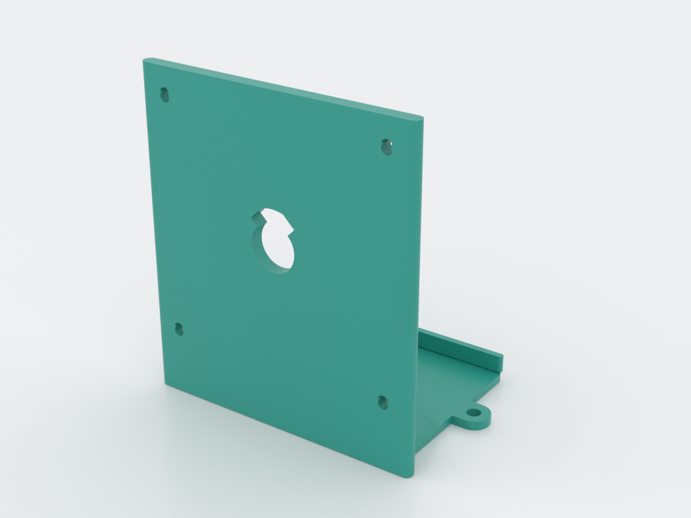
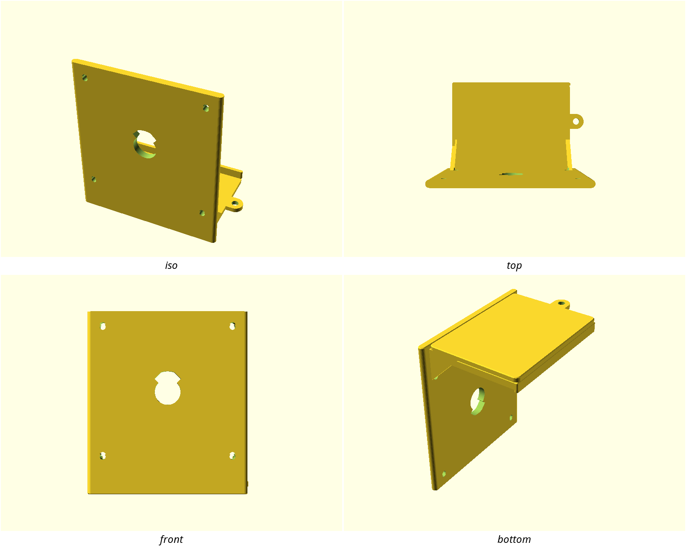

# VESA shelf

A behind-monitor tray that bolts onto your display's VESA holes and puts a
Raspberry Pi, mini-PC, slim video bar, USB hub, or cable loop in the dead
space behind an arm-mounted screen — no straps, no adhesives.

## What you get

- `shelf` — one printable part: VESA plate (4× M4 clearance + optional centre
  cable pass), cantilever tray with front lip, one closed side, open cable
  edge, and a cable-loop ear. About 120 × 86 × 147 mm at the 100 × 100
  default (plate width × overall depth × height).

## Print settings

- **Material:** PETG preferred (loaded cantilever); PLA fine at the 400 g
  rated payload
- **Layer height:** 0.2 mm
- **Infill:** 25 % gyroid
- **Supports:** none — tray on the bed, plate standing, 45° gussets,
  teardrop M4 bores
- **Orientation:** as rendered — tray floor flat on the bed
- **Perimeters:** ≥ 3 (the 6 mm plate is the load path)

## Parameters

| Parameter | Default | What it does |
|---|---|---|
| `vesa_pitch` | 100 mm | Square VESA MIS-D pitch (75 or 100) |
| `plate_t` | 6 mm | Plate thickness; part of the screw-engagement budget |
| `tray_w` / `tray_d` | 110 / 80 mm | Tray floor size (Pi 4 case fit with margin) |
| `tray_drop` | 25 mm | How far below the lower VESA holes the tray hangs |
| `payload_g` | 400 g | Rated payload — drives the root-stress assert |
| `screw_len` | 16 mm | Purchased screw length under the head |
| `cable_pass_d` | 20 mm | Centre cable pass (0 disables) |

All parameters are at the top of `vesa-shelf.scad`, grouped in Customizer
sections; override on the command line with `-D 'vesa_pitch=75'`.

## Bill of hardware

Purchased — nothing threads into the print:

| Qty | Item | Notes |
|---|---|---|
| 4 | M4×0.7 machine screw, 16 mm under head | Into the display's VESA inserts |
| 4 | M4 flat washer (~1 mm) | Under the screw head against the plate |

**Engagement budget.** VESA MIS-D typical max engagement into the display is
10 mm. With the defaults (`plate_t=6` + `washer_t=1` + `screw_len=16`) you
get 9 mm into the insert. If you use longer screws, thicken the plate or add
spacers so engagement stays ≤ 10 mm — the model `assert`s this at render
time.

## Assembly & use

1. Confirm your monitor (or arm) exposes a 100 × 100 or 75 × 75 VESA pattern
   and that the **arm head does not fully cover** those four holes. Some
   arm heads do — this design cannot reach through a covered pattern.
2. Confirm behind-monitor clearance ≥ `tray_d` (80 mm default) for the tray
   depth you chose.
3. Print `shelf` tray-down, no supports.
4. Bolt the plate to the display with the four M4 screws and washers —
   tray hanging **below** the hole pattern, open cable edge to the side you
   want cable access.
5. Set the device on the tray; loop spare cable through the ear if useful.

To switch to 75 × 75, render with `-D 'vesa_pitch=75'` (Customizer also
offers it). Do not invent other pitches — only published MIS-D square
patterns are supported.
